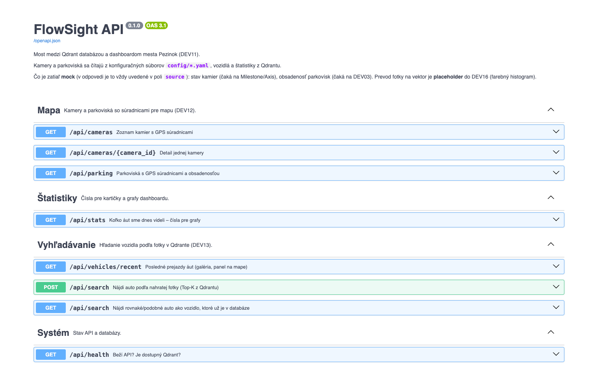

# DEV11: FastAPI Server

## Cieľ
Vytvoriť REST API, ktoré bude slúžiť ako most medzi Qdrant databázou a webovým dashboardom. Endpointy: `/search` (podľa obrázka/vektora), `/stats` (štatistiky), `/cameras` (zoznam kamier), `/parking` (parkoviská).

## Vstup
- Qdrant databáza.
- Požiadavky z frontendu.

## Výstup
- JSON odpovede.

## Postup
1. Vytvoriť FastAPI aplikáciu.
2. Implementovať endpointy.
3. Otestovať cez Swagger UI (`/docs`).

## Definition of Done
- [x] API beží na localhoste.
- [x] Endpointy vracajú dáta z Qdrant.
- [x] Swagger dokumentácia funguje (`/docs`).

---

## Čo je spravené



FastAPI server, ktorý číta kamery a parkoviská z **konfiguračných súborov** (`config/*.yaml`) a vozidlá
a štatistiky z **Qdrantu** (rovnaké kolekcie a formát bodov ako pipeline v `rd-research/02-multi-view-reid`).
Server zároveň servíruje celý `dev-dashboard`, takže mapa (DEV12) aj vyhľadávanie (DEV13) bežia z jednej adresy.

| Endpoint | Čo vráti | Odkiaľ sú dáta |
|---|---|---|
| `GET /api/cameras` | 41 kamier s GPS, stavom a počtom áut dnes (filter `?status=`, `?area=`) | `config/cameras.yaml` + Qdrant, stav je mock |
| `GET /api/cameras/{id}` | detail jednej kamery | to isté |
| `GET /api/parking` | 12 parkovísk Pezinka s GPS, polygónom, kapacitou a obsadenosťou + súhrn | `config/parking.yaml`, obsadenosť je mock (DEV03) |
| `GET /api/stats` | prejazdy dnes, za poslednú hodinu (aj zmena v %), „v zábere teraz“, graf po hodinách za 24 h, top kamery | Qdrant (`vehicles_reid`) |
| `POST /api/search` | Top-K podobných áut k nahratej fotke (multipart `image`, `top_k`, `camera`, `from`) | Qdrant, vektor = placeholder do DEV16 |
| `GET /api/search?vehicle_id=` | autá podobné vozidlu, ktoré už je v DB (bez DEV16 – použije uložený vektor) | Qdrant |
| `GET /api/vehicles/recent` | posledné prejazdy so záberom (galéria, panel na mape) | Qdrant |
| `GET /api/health` | beží API? je dostupný Qdrant? koľko bodov má ktorá kolekcia | – |
| `/media/...` | zábery (`frames/`, `crops/`), na ktoré ukazujú cesty v Qdrante | `data/` |
| `/dashboard/...` | statické stránky DEV12 a DEV13 | `dev-dashboard/` |

Každá odpoveď hovorí v poli `source`, či sú dáta z `config`, `qdrant` alebo `mock` – nič sa nevydáva za reálne.

Detaily:
- **Vyhľadávanie** vracia každé auto iba raz (v Qdrante má auto viac pohľadov/prejazdov – zoskupuje sa podľa `original_id`), takže Top-3 = 3 rôzne autá. Filtre kamera a čas sa robia priamo v Qdrante. Kontrakt odpovede sedí s frontendom DEV13 (`results[].score`, `payload`, `image_url`).
- **Prevod fotky na vektor** (`app/embedder.py`) je zatiaľ náhradný – farebný HSV histogram s dĺžkou 512 (rovnaká ako ReID vektor). Skutočný ReID model je TensorRT engine a beží iba na NVIDIA GPU. Po DEV16 sa vymení iba trieda `Embedder`.
- **Štatistiky** sa počítajú ku času posledného záznamu v DB (pole `as_of`). Pri živej pipeline je to „teraz“.
- Neplatný obrázok, príliš veľký súbor (> 10 MB) alebo zlý čas vrátia zrozumiteľnú chybu 4xx; keď Qdrant nebeží, `/search` vráti 503 a `/stats` prejde na mock.
- CORS je povolený, frontend môže bežať aj z iného portu.

## Spustenie

```bash
cd dev-dashboard/DEV11-FastAPI-server
python -m venv .venv && source .venv/bin/activate
pip install -r requirements.txt

python scripts/seed_qdrant.py          # naplní lokálny Qdrant ukážkovými prejazdmi (~4 s)
uvicorn app.main:app --reload --port 8000
```

- Dashboard: http://127.0.0.1:8000/ (otvorí mapu DEV12, z nej sa ide na udalosti a vyhľadávanie DEV13)
- Swagger: http://127.0.0.1:8000/docs
- Vyhľadávanie (DEV13) si adresu API zistí samo, keď ho servíruje tento server. Kamery, galériu aj výsledky berie odtiaľto.

Pred prezentáciou spusti `seed_qdrant.py` znova, nech je „dnes“ v štatistikách aktuálne.

### Ukážková databáza
`scripts/seed_qdrant.py` vytvorí v `qdrant_data/` (nie je v gite) kolekcie `vehicles_reid` a `vehicles_dashboard`.
Zábery sú skutočné (103 áut z `data/frames`, RoundaboutHD), ale kamery a časy sú vymyslené:
~1 200 prejazdov za deň za posledných 48 h, rozložené podľa dennej doby (ranná a popoludňajšia špička).
Na Qdrant v Dockeri: `docker run -p 6333:6333 qdrant/qdrant`, potom `python scripts/seed_qdrant.py --url http://localhost:6333`
a v `config/settings.yaml` nastav `qdrant.url`.

### Testy

```bash
python -m pytest -q
```

13 testov nad vlastnou dočasnou databázou: health, Swagger, GPS kamier, parkoviská, štatistiky (súčty sedia),
vyhľadávanie (Top-3 sú 3 rôzne autá, rovnaký záber je prvý, filtre kamera/čas), chybné vstupy, CORS, zábery, servírovanie dashboardu.

## Konfigurácia

| Súbor | Obsah |
|---|---|
| `config/settings.yaml` | Qdrant (url alebo lokálny súbor), názvy kolekcií, priečinok so zábermi, CORS, limity |
| `config/cameras.yaml` | 41 mestských kamier: id, číslo, názov, ulica, časť mesta, typ, GPS. Voliteľne `heading` (smer v stupňoch) – mapa potom nakreslí výhľad kamery |
| `config/parking.yaml` | 12 parkovísk Pezinka z OpenStreetMap: názov, ulica, typ, kapacita a jej zdroj, GPS stred, polygón, kamery do 200 m |

Kameru alebo parkovisko pridáš novou položkou v YAML – API aj mapa ju po reštarte zobrazia.
`scripts/build_config.py` vygeneroval YAML zo zoznamu kamier MsP Pezinok (DEV13 `data/cameras.js`, polohy overené voči
OpenStreetMap, kamera 3 opravená) a z `scripts/data/pezinok_parking_osm.geojson` (12 parkovísk `amenity=parking` z OSM).
Kapacita parkovísk je z OSM, z tlačovej správy (P+R pri stanici, 291 miest) alebo odhad z plochy – pole `capacity_source`.

## Čo ešte chýba
- skutočný ReID vektor pre `POST /api/search` → **DEV16**
- obsadenosť parkovísk z kamier → **DEV03**
- stav kamier (online/offline) z Milestone / Axis → **DEV08**
- pipeline zatiaľ ukladá `camera: "demo_cam"` a čas iba ako `HH:MM:SS` – treba id kamery z `config/cameras.yaml` a ISO dátum (API si poradí s oboma, ale bez dátumu berie „dnes“)

## Súbory
- `app/main.py` – endpointy
- `app/store.py` – práca s Qdrantom (vyhľadávanie, štatistiky)
- `app/embedder.py` – fotka → vektor (placeholder do DEV16)
- `app/mock.py` – ukážkové dáta pre stav kamier a obsadenosť
- `app/config.py`, `app/schemas.py` – nastavenia a tvary odpovedí pre Swagger
- `scripts/seed_qdrant.py`, `scripts/build_config.py`, `tests/`
