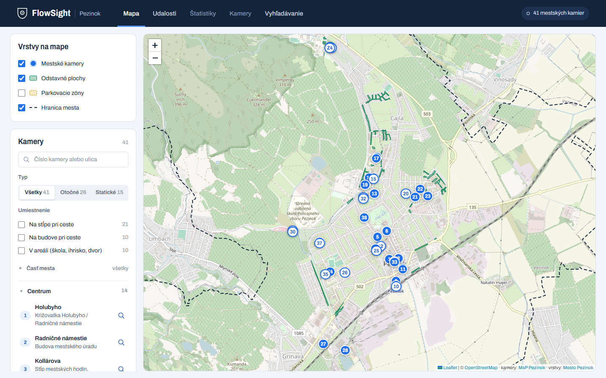

# DEV12: Interaktívna Mapa (Leaflet)

## Cieľ
Vytvoriť webovú stránku s mapou (inšpirácia vizualizáciou), na ktorej budú vrstvy: Kamery (klikateľné), Parkoviská (s aktuálnou obsadenosťou), Heatmapa ulíc.

## Vstup
- Dáta z API (DEV14).
- OpenStreetMap podklad.

## Výstup
- HTML/JS aplikácia.

## Postup
1. Použiť Leaflet.
2. Pridať vrstvy (kamery, parkoviská).
3. Pridať interaktivitu (kliknutie na kameru otvorí stram kamery (to neskôr), klik na parkovisko spraví interakciu etc...).

## Definition of Done
- [x] Mapa sa načíta.
- [x] Vrstvy sa dajú vypnúť/zapnúť.
- [x] Kamery sú klikateľné.

---

## Čo je spravené



Mapa Pezinka v Leaflete s podkladom z OpenStreetMap. Nič sa nebuildí, stačí otvoriť `mapa.html`, alebo spustiť server z priečinka `dev-dashboard`:

```
python -m http.server 8000
```

a ísť na http://localhost:8000/DEV12-interactive-map/mapa.html

Vrstvy (dajú sa zapnúť/vypnúť):
- mestské kamery, 41 kusov podľa zoznamu Mestskej polície Pezinok (2024)
- odstavné plochy a parkovacie zóny z mestských dát
- hranica mesta

Kamery:
- po kliknutí sa otvorí popup s miestom, typom kamery a tlačidlom na hľadanie vozidla na tejto kamere (otvorí DEV13 s predvybranou kamerou)
- v paneli vľavo sa dajú hľadať podľa čísla alebo ulice a filtrovať podľa typu (otočné/statické), umiestnenia a časti mesta
- `mapa.html?camera=msp-25` otvorí mapu priamo na danej kamere

Polohy kamier sú odhadnuté z adries a križovatiek cez OpenStreetMap, nie sú presné GPS súradnice. V popupe je napísané, ako presne je ktorá poloha určená.

Čo ešte chýba:
- obsadenosť parkovísk (treba dáta z API)
- heatmapa ulíc
- stream z kamery po kliknutí (podľa zadania neskôr)

## Súbory

- `mapa.html`, `map.js`, `map.css` – mapa
- `data/pezinok-layers.js` – parkoviská, zóny, hranica mesta
- `data/cameras.js` – zoznam kamier (rovnaký ako v DEV13)
- `styles.css` – spoločný vzhľad (rovnaký ako v DEV13)

Vyhľadávanie a udalosti sú v [DEV13](../DEV13-db-search-frontend/).
