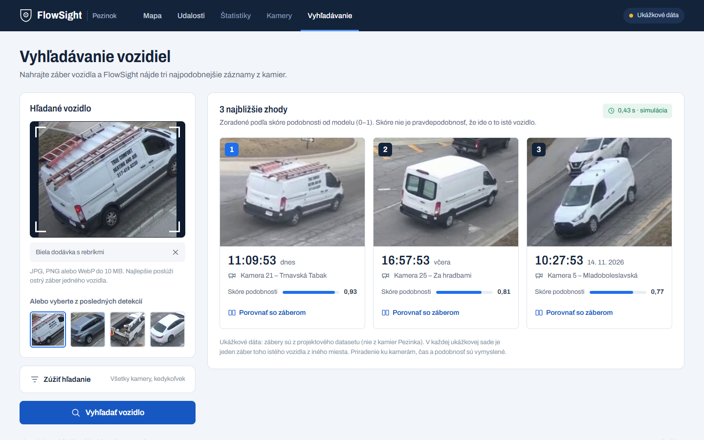

# DEV16: Vyhľadávací Dashboard (Frontend)

## Cieľ
Rozhranie (inšpirácia z AI vizualizácie, ale doplniť funkcie), kde používateľ nahrá obrázok auta (alebo vyberie z galérie) a systém mu vráti zoznam zhôd z Qdrant. Zobrazenie Top-3 výsledkov s časom a kamerou.

## Vstup
- API z DEV14.
- Obrázok od používateľa.

## Výstup
- Webová stránka s výsledkami.

## Postup
1. Vytvoriť HTML formulár na nahratie obrázka.
2. Poslať na API.
3. Zobraziť výsledky (obrázky, čas, kamera).

## Definition of Done
- [x] Nahrávanie obrázka funguje.
- [ ] Výsledky sa zobrazia do 2 sekúnd. (na ukážkových dátach áno, s reálnym API ešte neoverené)

---

## Čo je spravené



Frontend je čisté HTML, CSS a JS, nič sa nebuildí. Stačí otvoriť `index.html` v prehliadači, alebo spustiť server z priečinka `dev-dashboard`:

```
python -m http.server 8000
```

a ísť na http://localhost:8000/DEV13-db-search-frontend/

- nahratie fotky (presunutím alebo kliknutím), JPG/PNG/WebP do 10 MB, zlý súbor sa odmietne a pôvodná fotka zostane
- alebo výber z galérie posledných detekcií
- filter podľa času a kamier (kamery sú zoradené podľa častí mesta)
- top 3 výsledky s časom, kamerou a skóre podobnosti
- porovnanie hľadaného auta so záberom vedľa seba
- keď sa zmenia filtre, starý výsledok sa označí, aby ho nikto nebral ako aktuálny
- chybové stavy: server nebeží, timeout (15 s), zlá odpoveď, zábery sa nenačítali

Bez adresy API beží na ukážkových dátach (zábery z RoundaboutHD, kamery a časy sú vymyslené). Adresa API sa dá zadať dole v sekcii „Pre vývojárov“ alebo cez `?api=http://127.0.0.1:8000` v URL.

### Udalosti


Navyše je tu stránka `udalosti.html`, zatiaľ iba s ukážkovými udalosťami (požiar, jazda v protismere, dlhé státie...). Zábery ohňa sú z prototypu R&D 12. Je to návrh, ako by mohli vyzerať alerty v dashboarde, keď bude detekcia napojená.

## API (návrh, treba dohodnúť s DEV11/DEV14)

Request: `POST /api/search`, multipart

| pole | čo to je |
|---|---|
| `image` | fotka auta |
| `top_k` | koľko výsledkov (posielam 3) |
| `camera` | id kamery, môže byť viackrát; keď chýba, hľadá sa všade |
| `from` | ISO čas, od kedy hľadať; keď chýba, kedykoľvek |

Response:

```json
{
  "results": [
    {
      "score": 0.91,
      "payload": {
        "original_id": "aaa",
        "frame_path": "frames/aaa_best.jpg",
        "timestamp": "2026-11-17T08:15:00",
        "camera": "msp-21"
      }
    }
  ]
}
```

Prispôsobil som to Jánovej pipeline (`rd-research/02-multi-view-reid`), takže stačí poslať body z Qdrantu tak, ako sú. Ak príde to isté auto viackrát (spredu, zboku...), ukáže sa iba jeho najlepší pohľad. Obrázok berie z `image_url`, `frame_path`, `best_frame_path` alebo `reid_crop_path`. Relatívne cesty sa skladajú s adresou API, takže backend musí tie súbory servírovať.

Čo ešte treba vyriešiť:
- `timestamp` je teraz iba čas spracovania (`HH:MM:SS`), chýba dátum a reálny čas záznamu
- `camera` je zatiaľ `demo_cam`, treba id kamier ako v `data/cameras.js` (`msp-1` ... `msp-38`, `msp-z2` ... `msp-z4`)
- CORS na serveri, inak prehliadač request zablokuje

## Súbory

- `index.html`, `app.js` – vyhľadávanie
- `udalosti.html`, `events.js`, `events.css` – udalosti
- `styles.css` – spoločný vzhľad (rovnaký súbor je aj v DEV12)
- `data/cameras.js` – zoznam 41 mestských kamier (podľa MsP Pezinok)
- `data/events.js` – ukážkové udalosti
- `assets/` – ukážkové zábery

Mapa je v [DEV12](../DEV12-interactive-map/), stránky sú medzi sebou prelinkované.
