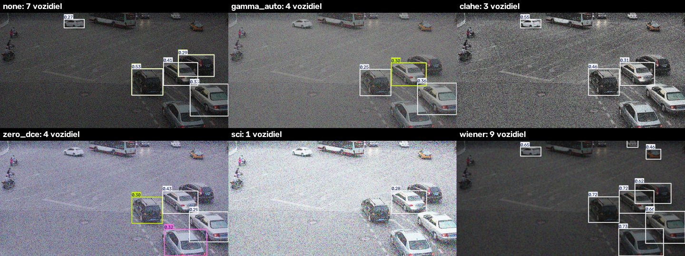
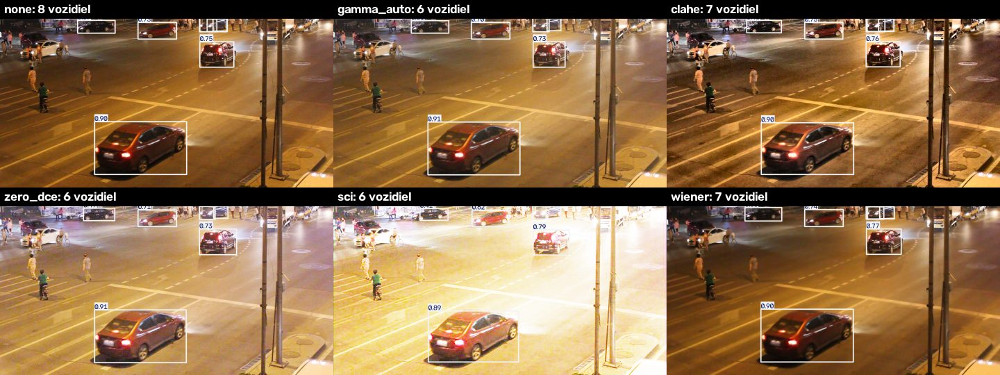
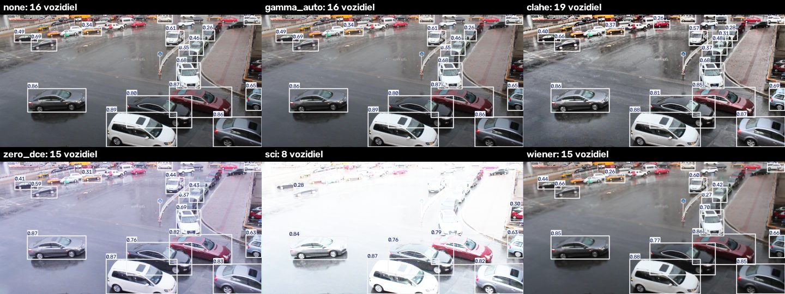
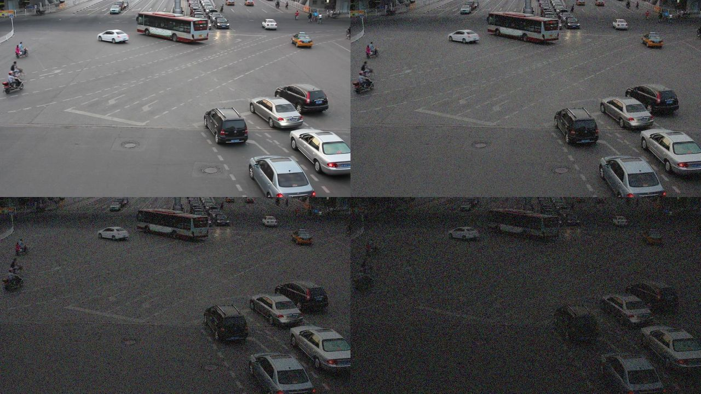

# Task 4: YOLO v nepriaznivých podmienkach (noc, dážď)

> **Stav:** hotové (prieskum + experimenty + skript). Riešil: Peter Štefanec, Jira SCRUM-8.
> Čísla v reporte sú namerané skriptmi v tomto priečinku (súbory v `results/`). Čísla prevzaté z článkov majú vždy uvedený zdroj.

## TL;DR (na prezentáciu)

1. **V noci YOLO neškodí tma, ale šum.** Zosvetlenie obrazu (gama, ekvalizácia, Retinex, neurónky SCI a Zero-DCE++) vyzerá pre človeka lepšie, ale detekciu YOLO **takmer vždy zhorší**:
   - na umelo stmavenej kamere o 0,09 až 0,41 mAP50;
   - na ExDark o 0,04 až 0,19. Výnimkou je CLAHE, ktoré je neutrálne.
   - Výnimka: na fotkách z dažďa (DAWN) CLAHE a ekvalizácia mierne pomohli (+0,02 až +0,03, na hrane šumu pri 200 snímkach). Na pevnej kamere v daždi to neplatilo.
   - Rovnako to opisuje literatúra (YOLA, IA-YOLO, CVPR 2019 deraining benchmark).
2. **Pri umelo stmavenom a zašumenom zábere pomáha odšumenie.** Wienerov filter zvýši mAP50 z 0,632 na **0,803 (+0,17)**, bilaterálny filter na 0,718 (+0,09). Na reálnom zašumenom zábere to zatiaľ nie je overené, žiadny z reálnych datasetov nemal vysoký šum.
3. **Na reálnych nočných a daždivých záberoch z pevnej dopravnej kamery (UA-DETRAC) nepomohla žiadna lacná metóda o viac ako ~0,01 mAP50.**
   - YOLOv8n (COCO) zvláda osvetlenú mestskú noc dobre (mAP50 0,883 vs. 0,874 cez deň).
   - Najväčší problém je **dážď**: mAP50 0,793, recall 0,64 vs. 0,80 cez deň.
4. **Výstup:** [`night_enhance.py`](night_enhance.py) odhadne šum snímky (0,25 ms). Ak je šum vysoký, použije Wienerov filter, inak nechá snímku tak.
   - Na všetkých testovaných reálnych dátach je výsledok **zhodný s baseline** (na ExDark sa filter zapol na ~1 % snímok).
   - Na umelo zašumených dátach pridá **+0,02 až +0,17 mAP50** podľa úrovne šumu.
5. **Dotrénovanie YOLO** na 1 048 nočných a daždivých snímkach z 3 lokalít **zatiaľ nepomohlo** na lokalitách, ktoré model nevidel.
   - Pri pevnom prahu conf má síce vyšší recall, ale nižšiu precision. Pri rovnakej precision (0,9) je recall rovnaký alebo horší ako pri pôvodnom modeli.
   - Model sa zhoršil cez deň (0,875 → 0,761).
   - Oproti kontrolnému modelu dotrénovanému na rovnakom počte denných snímok je lepší v noci (+0,054 mAP50), v daždi rovnako dobrý.
6. **Odporúčanie pre FlowSight:**
   - globálne zosvetľovanie **nepoužívať**;
   - `NightEnhancer("auto")` sa dá zapnúť (na testovaných reálnych dátach neuškodil; na reálnom zašumenom zábere ho treba ešte overiť);
   - investovať do (a) **nastavení kamery** (IR, maximálna uzávierka, gain, WDR) a (b) **dotrénovania na označených záberoch z Pezinka**, s viacerými kamerami a dňom, nocou aj dažďom spolu.


*Umelo stmavený záber z UA-DETRAC (fyzikálny model: menej svetla, šum senzora, JPEG). Zosvetlenie (gamma_auto, CLAHE, Zero-DCE++, SCI) zosilní šum a YOLO nájde menej áut. Wienerov filter šum odstráni a YOLO nájde viac áut s vyššou istotou.*

---

<details>
<summary><b>Pôvodné zadanie</b> (klikni)</summary>

**Zadanie:** Ako zlepšiť detekciu YOLO v noci a v daždi? Čo je najrýchlejšie výpočtovo?

**Čo treba spraviť:**
- nájsť a stiahnuť videá z ciest, kamier za zlých podmienok napr.
- Preštudovať papers o Low-light Object Detection, štúdia YOLO v nepriaznivých podmienkách.
- Vyskúšať metódy: zosvetlenie pixelov (napr. gama korekcia), Wienerov filter, alebo dotrénovanie YOLO na nočných dátach.
- Vyskúmať iné metódy detekcie v nepriaznivých podmienkách, nastavenia kamier, ktoré by zlepšili viditeľnosť.
- Zmerať, koľko ms/GFLOPS to zaberie (aby sme neplytvali výkonom).

**Podklady:** Dataset 4 ročné obdobia veľa obrázkov https://github.com/SKKUAutoLab/TSBOW dá sa použiť aj iné.

**Report:** Porovnanie metód (tabuľka: metóda, zlepšenie detekcie, časová náročnosť).

**Výstup:** Skript, ktorý zoberie nočný záber a zlepší ho pre YOLO.
</details>

| Bod zadania | Kde |
|---|---|
| Videá a dáta za zlých podmienok | [§2 Dáta](#2-dáta) |
| Papers o low-light / adverse detection | [§6 Literatúra](#6-čo-hovorí-literatúra) |
| Gama, Wiener, dotrénovanie YOLO a ďalšie metódy | [§4 Výsledky](#4-výsledky) |
| Nastavenia kamier | [§7](#7-nastavenia-kamery-často-pomôžu-viac-ako-algoritmus) |
| ms a GFLOPs | [§4.6](#46-výpočtová-náročnosť) |
| Tabuľka: metóda – zlepšenie – čas | [§4.1](#41-hlavná-tabuľka-metóda--zlepšenie-detekcie--čas) |
| Skript, ktorý zlepší nočný záber pre YOLO | [`night_enhance.py`](night_enhance.py) |

---

## 1. Súbory a spustenie

| Súbor | Čo robí |
|---|---|
| [`night_enhance.py`](night_enhance.py) | **Výstup úlohy.** Obrázok alebo video: v režime `auto` použije Wiener pri vysokom šume, inak nič. `--compare` uloží porovnanie s detekciami YOLO vedľa seba. Trieda `NightEnhancer` sa dá použiť priamo v pipeline. |
| [`enhance.py`](enhance.py) | 13 metód predspracovania (+ `none`) s rovnakým rozhraním `bgr → bgr`: gama, adaptívna gama, HE, CLAHE, Retinex, Wiener, bilaterálny filter, NL-means, dehaze, SCI, Zero-DCE++ |
| [`eval_detection.py`](eval_detection.py) | Vyhodnotenie: predspracovanie → YOLO → mAP50, mAP50-95, recall, precision, recall pri precision ≥ 0,9, zvlášť pre noc, dážď a deň. Obsahuje aj fyzikálny model umelého stmavenia. Predikcie si ukladá do cache. |
| [`benchmark.py`](benchmark.py) | ms/snímka (960×540 aj 1080p) a GFLOPs každej metódy aj YOLO |
| [`finetune_detrac.py`](finetune_detrac.py) | Experiment s dotrénovaním YOLO: príprava dát s delením podľa lokality a tréning |
| [`make_figures.py`](make_figures.py) | Obrázky v `results/figures/`, analýza nočného videa z repozitára, jas a šum podľa datasetu, ExDark podľa jasu |
| [`download_data.sh`](download_data.sh), [`fetch_detrac.py`](fetch_detrac.py), [`download_weights.py`](download_weights.py) | Stiahnutie testovacích dát (~450 MB) a váh SCI a Zero-DCE++ (~100 kB). Nič z toho nie je v gite. |

```bash
pip install -r requirements.txt
python download_weights.py                       # váhy SCI a Zero-DCE++ (potrebné pre benchmark a hodnotenie všetkých metód)
# zlepšenie nočného videa + porovnanie s detekciami (model ../../models/yolov8n.pt je predvolený)
python night_enhance.py --source ../../data/videos/nocne_video_360p.mp4 --out runs/out.mp4 --compare --max-seconds 20   # runs/ sa vytvorí sám
# v kóde:  from night_enhance import NightEnhancer;  frame = NightEnhancer()(frame)

# reprodukcia experimentov (výstupy do runs/, ktorý je v .gitignore)
./download_data.sh && python download_weights.py
D="--dataset detrac --detrac-frames data/uadetrac_frames --detrac-xml data/DETRAC-Test-Annotations-XML"
python eval_detection.py $D --every 2 --methods none,auto,gamma,gamma_auto,he,clahe,gamma_clahe,msr,wiener,wiener_gamma,bilateral,nlmeans,dehaze,sci,zero_dce --out runs/detrac_real.csv
python eval_detection.py $D --only-cond sunny,cloudy --every 2 --synthetic-dark dusk,dark,very_dark --methods none,auto,gamma,gamma_auto,he,clahe,gamma_clahe,msr,wiener,wiener_gamma,bilateral,dehaze,sci,zero_dce --out runs/detrac_synth.csv
python eval_detection.py --dataset yolo --yolo-dir data/exdark/data/test --yolo-classes 0,3,4,9 --vehicle-classes 1,2,3,5,7 --cond exdark_night --methods none,auto,gamma,gamma_auto,he,clahe,gamma_clahe,msr,wiener,wiener_gamma,bilateral,nlmeans,dehaze,sci,zero_dce --out runs/exdark.csv
python eval_detection.py --dataset yolo --yolo-dir data/dawn --yolo-classes 3,4,6,8 --cond dawn_rain --methods none,auto,gamma,gamma_auto,he,clahe,gamma_clahe,msr,wiener,wiener_gamma,bilateral,nlmeans,dehaze,sci,zero_dce --out runs/dawn.csv
python benchmark.py --image data/uadetrac_frames/MVI_40742/img00001.jpg --out runs/benchmark.csv
```

## 2. Dáta

Hľadal som hlavne dáta s **anotáciami vozidiel**. Bez nich sa zlepšenie detekcie nedá zmerať, len odhadnúť okom.

| Dataset | Čo to je | Použité | Prečo |
|---|---|---|---|
| **UA-DETRAC** (Wen et al., CVIU 2020) | **Pevná dopravná kamera nad križovatkami** (Peking, Tchien-ťin), 960×540, 25 fps. Sekvencie sú označené: noc, dážď, zamračené, slnečné. | Test set: 12 nočných, 9 daždivých a 8 denných sekvencií, z nich každý 10. snímok, spolu **4 191 snímok**. Na hodnotenie metód beriem každý 2. z nich: 2 096 snímok, 22 792 platných áut. | **Najbližšie k Pezinku:** pevná kamera, podobný uhol pohľadu |
| **ExDark** (Loh & Chan, CVIU 2019) | Fotky za zlého svetla z internetu, 12 tried | Test split: 734 snímok, 600 vozidiel (auto, bus, motorka, bicykel) | Naozaj tmavé snímky (medián jasu 32/255). Nie je to však CCTV. |
| **DAWN Rain** (Kenk & Hassaballah, 2020) | Fotky vozidiel v daždi | 200 snímok, 1 560 vozidiel | Silný dážď, kvapky, rozmazanie |
| **Umelá tma** | Denné snímky UA-DETRAC prevedené fyzikálnym modelom na nočné (podľa MAET): linearizácia → menej fotónov → šum senzora (shot + read) → gama → JPEG 75 | 524 denných snímok × 3 úrovne (*dusk*, *dark*, *very_dark*) | Kontrolovaný experiment: tie isté autá pri rôznej tme |
| `data/videos/nocne_video_360p.mp4` (repozitár) | Zostrih z niekoľkých skutočných nočných dopravných kamier, veľmi tmavé (medián jasu 11/255) | ~18 min (32 704 snímok), vyhodnotená každá 15. snímka, teda 2 181 snímok. **Bez anotácií.** | Reálna nočná CCTV |
| 5 voľne licencovaných videí (Pexels, Mixkit, Wikimedia) | Noc a dážď na ceste | Len ukážky | |

**TSBOW** (odporúčaný v zadaní) je na Hugging Face **zamknutý**:
- Treba podpísať formulár a poslať e-mail trom autorom, schválenie trvá 2–3 dni.
- Celý má ~31 GB a licenciu CC BY-NC-ND.
- Podľa karty datasetu obsahuje hlavne denné scény (dážď, hmla, sneh), noc pravdepodobne nie.
- Pre druhý týždeň sa oň dá zažiadať.

<p align="center"> </p>

*Vľavo reálna noc z UA-DETRAC (osvetlená križovatka), vpravo reálny dážď. YOLO funguje dobre aj bez úprav a predspracovanie počty áut skoro nezmení.*

## 3. Metodika

- **Detektor:** `yolov8n.pt` (COCO, rovnaký ako v repozitári), **imgsz 512** ako na Jetsone. Triedy car, motorcycle, bus a truck sa zlúčia do jednej triedy „vehicle“, lebo každý dataset delí vozidlá inak. Pre ExDark pribudne aj bicycle.
- **Metriky:**
  - mAP50 a mAP50-95 (101-bodová interpolácia ako v COCO);
  - recall a precision pri conf 0,25;
  - **recall pri precision ≥ 0,9**, ktorý nezávisí od zvoleného prahu.
- **Ignorované oblasti UA-DETRAC** (kde autá nie sú označené): anotácie so stredom v nich sa nepočítajú. Detekcie v nich sa nepočítajú ako chyba (podobne ako „crowd“ v COCO).
- **Deň** = všetky slnečné a zamračené snímky vyhodnotené spolu.
- **Vždy rovnaký baseline:** ten istý model na neupravenej snímke. Pri metódach sa mení len predspracovanie.
- **Rozdiely do ~0,01 mAP50 považujem za šum.** Je to odhad, nie zmeraný interval spoľahlivosti. Na menších sadách (ExDark 600 vozidiel, DAWN 200 snímok) môže byť šum aj väčší.
- **Časy:** M2 MacBook (CPU pre OpenCV operácie, MPS GPU pre CNN), medián z 30 meraní (NL-means z 5), merané na inak nezaťaženom stroji. **Na Jetsone budú čísla iné**, porovnávať treba len poradie metód.

## 4. Výsledky

### 4.1 Hlavná tabuľka: metóda → zlepšenie detekcie → čas

mAP50 (v zátvorke rozdiel oproti baseline, kladné = lepšie):

| Metóda | UA-DETRAC noc | UA-DETRAC dážď | UA-DETRAC deň | umelá tma *dark* | ExDark (noc) | DAWN (dážď) | ms @960×540 | ms @1080p | GFLOPs @960×540 |
|---|---|---|---|---|---|---|---|---|---|
| bez úpravy (baseline) | 0.883 | 0.793 | 0.874 | 0.632 | 0.619 | 0.660 | 0 | 0 | 0 |
| **auto ([`night_enhance.py`](night_enhance.py))** | **0.883** | **0.793** | **0.874** | **0.803 (+0.171)** | **0.620 (+0.002)** | **0.660** | 0.25 (+21.5 pri šume) | 0.25 (+90 pri šume) | ~0 (0.04 pri šume) |
| gama 0.6 (LUT) | 0.880 (-0.003) | 0.788 (-0.005) | 0.874 (-0.001) | 0.477 (-0.156) | 0.577 (-0.042) | 0.643 (-0.017) | 0.47 | 2.18 | 0.003 |
| adaptívna gama | 0.882 (-0.001) | 0.793 | 0.874 | 0.442 (-0.191) | 0.513 (-0.106) | 0.660 | 0.86 | 3.53 | 0.004 |
| ekvalizácia histogramu | 0.872 (-0.010) | 0.765 (-0.028) | 0.857 (-0.018) | 0.508 (-0.124) | 0.513 (-0.106) | 0.676 (+0.016) | 1.43 | 6.46 | 0.021 |
| CLAHE | 0.879 (-0.004) | 0.770 (-0.023) | 0.872 (-0.002) | 0.538 (-0.094) | 0.621 (+0.002) | 0.684 (+0.025) | 4.19 | 17.6 | 0.031 |
| gama + CLAHE | 0.878 (-0.005) | 0.770 (-0.024) | 0.872 (-0.002) | 0.483 (-0.149) | 0.525 (-0.094) | 0.686 (+0.027) | 5.05 | 21.1 | 0.035 |
| Multi-Scale Retinex | 0.870 (-0.012) | 0.774 (-0.019) | 0.868 (-0.006) | 0.227 (-0.406) | 0.430 (-0.188) | 0.639 (-0.021) | 50.7 | 197 | 0.062 |
| **Wienerov filter** | 0.884 (+0.001) | 0.797 (+0.004) | 0.871 (-0.003) | **0.803 (+0.171)** | 0.590 (-0.029) | 0.653 (-0.007) | 21.5 | 90.1 | 0.041 |
| Wiener + gama | 0.882 | 0.798 (+0.004) | 0.871 (-0.003) | 0.774 (+0.142) | 0.564 (-0.055) | 0.653 (-0.007) | 22.6 | 93.6 | 0.046 |
| **bilaterálny filter** | 0.884 (+0.002) | 0.801 (+0.007) | 0.874 (-0.001) | **0.718 (+0.086)** | 0.603 (-0.016) | 0.657 (-0.002) | 4.25 | 16.8 | 0.47 |
| Non-local means | 0.884 (+0.001) | 0.806 (+0.012) | 0.867 (-0.008) | – | 0.607 (-0.012) | 0.618 (-0.041) | **401** | **1 579** | 17.5 |
| dehaze (dark channel) | 0.879 (-0.004) | 0.777 (-0.017) | 0.855 (-0.019) | 0.622 (-0.010) | 0.606 (-0.012) | 0.682 (+0.022) | 17.0 | 69.7 | 0.041 |
| SCI (CNN, 258 parametrov) | 0.823 (-0.060) | 0.582 (-0.211) | 0.722 (-0.152) | 0.252 (-0.381) | 0.550 (-0.068) | 0.335 (-0.325) | 10.6 | 39.4 | 0.25 |
| Zero-DCE++ (CNN, 10,5 k parametrov) | 0.880 (-0.003) | 0.772 (-0.021) | 0.868 (-0.007) | 0.409 (-0.223) | 0.560 (-0.059) | 0.633 (-0.027) | 15.1 | 55.9 | 0.11 |
| *pre porovnanie: YOLOv8n `predict` @512* | | | | | | | *8.6* | *8.9* | *5.67* |

**Počty:**
- UA-DETRAC: noc 925 snímok / 7 862 áut, dážď 646 / 10 251, deň 525 / 4 679.
- Umelá tma: 524 / 4 659.
- ExDark: 734 / 600.
- DAWN: 200 / 1 560.

Plné tabuľky (aj mAP50-95, recall, precision, recall pri P ≥ 0,9) sú v `results/*.csv`.

**Čo z tabuľky vyplýva:**
- **Na reálnych dátach z pevnej kamery (UA-DETRAC) nič výrazne nepomohlo.**
  - Najviac v daždi pomohlo NL-means (+0,012 mAP50), ale stojí 400 ms na snímku, 46× viac ako samotné YOLO. To sa neoplatí.
  - Bilaterálny filter dá +0,007 za 4 ms, čo je na hrane šumu.
- **CLAHE nie je spoľahlivé.** Na DAWN pomohlo (+0,025), na UA-DETRAC v daždi uškodilo (-0,023). Na inej kamere môže dopadnúť opačne.
- **SCI je nepoužiteľné.** Je navrhnuté pre veľmi tmavé fotky, normálne snímky preexponuje a detekcia padne o 0,06–0,38.
- **Zosvetľovanie nepomohlo ani na najtmavších snímkach ExDark** (jas 0–15, 39 snímok, 64 vozidiel), pozri [`results/exdark_by_brightness.json`](results/exdark_by_brightness.json):
  - adaptívna gama zhoršila mAP50 z 0,623 na 0,378;
  - Zero-DCE++ zhoršil mAP50 na 0,486;
  - CLAHE bolo neutrálne (0,638).

### 4.2 Umelá tma: čím tmavšie, tým viac záleží na šume

Rovnaká sada 524 denných snímok, postupne tmavšia a zašumenejšia. Čísla sú mAP50, jas a šum z [`results/noise_by_dataset.json`](results/noise_by_dataset.json).

| Metóda | deň (originál) | *dusk* (jas ~78, šum σ≈8) | *dark* (jas ~55, σ≈13) | *very_dark* (jas ~40, σ≈19) |
|---|---|---|---|---|
| bez úpravy | 0.875 | 0.823 | 0.632 | 0.052 |
| **auto / Wiener** | 0.875 / 0.873 | **0.846 (+0.023)** | **0.803 (+0.171)** | 0.168 (+0.115) |
| bilaterálny filter | 0.874 | 0.838 (+0.015) | 0.718 (+0.086) | 0.076 (+0.024) |
| Wiener + gama | 0.873 | 0.843 (+0.020) | 0.774 (+0.142) | 0.091 (+0.039) |
| CLAHE | 0.872 | 0.803 (-0.021) | 0.538 (-0.094) | 0.074 (+0.022) |
| adaptívna gama | 0.875 | 0.802 (-0.021) | 0.442 (-0.191) | 0.019 (-0.033) |
| Zero-DCE++ | 0.867 | 0.751 (-0.073) | 0.409 (-0.223) | 0.036 (-0.016) |
| SCI | 0.722 | 0.501 (-0.322) | 0.252 (-0.381) | 0.026 (-0.026) |
| Retinex | 0.869 | 0.705 (-0.118) | 0.227 (-0.406) | 0.010 (-0.042) |

- **Vysvetlenie:** YOLO zvláda tmavší obraz dobre, ale šum mu výrazne škodí. Zosvetlenie nepridá žiadnu informáciu, len zosilní šum a artefakty z kompresie JPEG. Odšumenie odstráni práve to, čo YOLO mätie.
- **Zosvetliť po odšumení nepomôže:** Wiener + gama je horší ako samotný Wiener (0,774 vs. 0,803).
- ***very_dark* je hranica.**
  - S Wienerom stúpne mAP50 na 0,17, ale recall pri conf 0,25 je len 0,02, takže v praxi je to nepoužiteľné.
  - Za touto hranicou treba riešiť **kameru** (IR prísvit, dlhšia uzávierka, iný senzor), nie softvér.

<details>
<summary>Ako vyzerajú úrovne umelej tmy (klikni)</summary>

Prvý riadok: deň a *dusk*. Druhý riadok: *dark* a *very_dark*. Človek autá stále vidí, ale YOLO pri *very_dark* takmer nič.
Úrovne generuje `synth_low_light()` v [`eval_detection.py`](eval_detection.py) (násobok svetla 0,45 / 0,22 / 0,10, šum čítania σ = 4 / 6 / 8, JPEG 75).


</details>

### 4.3 Skutočná tmavá nočná kamera (video z repozitára)

`nocne_video_360p.mp4` (zostrih z niekoľkých nočných dopravných kamier) je veľmi tmavé (medián jasu ~11/255) a má málo šumu (σ≈0,4, kompresia ho vyhladí). Anotácie nemá, preto je to **len orientačné**.

Pre každú metódu som spočítal, v koľkých z 2 181 snímok YOLO našlo aspoň jedno vozidlo ([`results/repo_night_video_counts.json`](results/repo_night_video_counts.json)):

| Metóda | snímky s vozidlom | priemerná istota detekcie |
|---|---|---|
| bez úpravy / **auto** | 61 / **61** | 0.59 |
| adaptívna gama | 266 (4,4×) | 0.36 |
| SCI | 215 | 0.39 |
| Zero-DCE++ | 182 | 0.40 |
| CLAHE | 115 | 0.46 |
| Wiener | 49 | 0.56 |

**Sú detekcie navyše skutočné autá?**
- **Ručná kontrola:** pozrel som 16 snímok, kde gama našla auto navyše ([`results/figures/repo_night_gamma_extra_detections.jpg`](results/figures/repo_night_gamma_extra_detections.jpg)). Väčšinou sú to malé vzdialené autá, ale **niekoľko je zjavne falošných**, napr. „truck 0.58“ na zábradlí alebo detekcia na tmavej ploche.
- **Anotované dáta:** na ExDark aj umelej tme zosvetlenie takmer vždy znížilo mAP.
- **Záver:** na takýchto kamerách treba zosvetlenie **najprv overiť na niekoľkých desiatkach ručne označených snímok z Pezinka**. V `night_enhance.py` je dostupné cez `--method gamma_auto`, predvolene je vypnuté.

### 4.4 Adaptívny režim `auto` (výstup úlohy)

`night_enhance.py` odhadne šum snímky metódou Immerkær (1996) na strednom výreze 480×270, čo trvá 0,25 ms pri ľubovoľnom rozlíšení. Wiener použije len pri σ > 4.

Jas a šum pre UA-DETRAC a umelú tmu sú z ~30 vzoriek. Podiely 0 % a 100 % potvrdzuje aj to, že `auto` dáva na celých sadách presne rovnaké výsledky ako baseline, resp. Wiener.

| Typ záberu | jas (medián) | šum σ (medián / p95) | podiel snímok, kde `auto` zapne Wiener |
|---|---|---|---|
| UA-DETRAC deň | 114 | 1,5 / 1,8 | 0 % |
| UA-DETRAC noc | 91 | 0,7 / 2,1 | 0 % |
| UA-DETRAC dážď | 120 | 0,7 / 1,7 | 0 % |
| ExDark | 32 | 0,7 / 2,6 | 1 % |
| video z repozitára | 11 | 0,4 / 0,7 | 0 % |
| umelá tma *dusk* / *dark* / *very_dark* | 78 / 55 / 40 | 8,3 / 13,2 / 18,9 | 100 % |

**Výsledok:**
- **Reálne dáta:** výsledok je zhodný s baseline (ExDark +0,002 zo snímok, kde sa filter zapol).
- **Zašumené dáta:** výsledok je rovnaký ako pri Wieneri (+0,02 / +0,17 / +0,12).
- Inými slovami: neuškodí, a keď treba, pomôže.

### 4.5 Dotrénovanie YOLO na nočných a daždivých dátach

Pri inferencii nestojí nič navyše, takže je to najlacnejšia metóda pre Jetson. Experiment je v [`finetune_detrac.py`](finetune_detrac.py).

**Návrh experimentu:**
- **Delenie podľa lokality kamery, nie podľa snímok**, aby test nebol na tom istom mieste:
  - tréning: noc na lokalitách B a C, dážď na lokalite G (13 sekvencií);
  - test: noc na lokalitách A a D, dážď na lokalitách E a F (8 sekvencií, ktoré model **nikdy nevidel**).
- **Kontrolný model:** rovnaký počet denných snímok (1 048) s rovnakým nastavením. Ukáže, koľko zlepšenia pochádza len z prispôsobenia sa UA-DETRAC (štýl anotácií, uhol kamery).
- **Nastavenie:**
  - YOLOv8n z COCO váh, 15 epoch, imgsz 512, 1 trieda „vehicle“, augmentácia jasu (`hsv_v=0.5`);
  - ignorované oblasti sú v trénovacích snímkach zamaskované a anotácie z nich sú vynechané;
  - vyhodnotený je `last.pt`. Pozor: `best.pt` sa vyberá podľa testovacích lokalít, takže jeho čísla by boli nadhodnotené.

| Model | noc mAP50 | noc recall @0,25 / precision | **noc recall pri P≥0,9** | dážď mAP50 | dážď recall @0,25 / precision | **dážď recall pri P≥0,9** | deň mAP50 |
|---|---|---|---|---|---|---|---|
| YOLOv8n COCO (bez dotrénovania) | **0.928** | 0.866 / 0.912 | **0.872** | **0.788** | 0.608 / 0.943 | **0.677** | **0.875** |
| dotrénovaný na **noc + dážď** | 0.916 | 0.898 / 0.802 | 0.868 | 0.753 | 0.685 / 0.848 | 0.647 | 0.761 |
| dotrénovaný na **deň** (kontrola) | 0.861 | 0.790 / 0.847 | 0.757 | 0.755 | 0.709 / 0.781 | 0.640 | (trénovaný na ňom) |

*(Test tvoria len testovacie lokality, preto sa čísla COCO modelu líšia od §4.1.)*

**Čo z toho vyplýva:**
- **Na nových lokalitách dotrénovanie zatiaľ nepomohlo.**
  - Pri pevnom prahu conf 0,25 má dotrénovaný model vyšší recall (dážď 0,608 → 0,685), ale **nižšiu precision**. Je to hlavne posun kalibrácie istoty modelu.
  - Pri rovnakej precision (0,9) je recall horší ako pri COCO modeli a mAP50 kleslo (v daždi o 0,035).
- **Nočné dáta pomáhajú viac ako denné, ale len v noci.** Oproti kontrolnému modelu je v noci lepší o +0,054 mAP50 a +0,11 recall pri P≥0,9, v daždi je rovnaký.
- **Model zabudol deň:** 0,875 → 0,761.
- **Dôvod:** 1 048 snímok z 3 lokalít nestačí. Model sa prispôsobí tým kamerám, ale pôvodný COCO model je trénovaný na veľkom množstve rôznych áut a je to silný baseline.
- **Ako to robiť v Pezinku:**
  - stovky až tisíce označených snímok z **viacerých kamier a v rôznych podmienkach** (deň + noc + dážď spolu, aby model nezabudol deň);
  - nižší learning rate alebo zmrazený backbone;
  - hodnotenie na kamere, ktorá v tréningu nebola;
  - označovanie urýchlia pseudo-labely z väčšieho modelu (napr. YOLOv8x) s ručnou kontrolou.

### 4.6 Výpočtová náročnosť

Z [`results/benchmark.csv`](results/benchmark.csv):

| | ms @960×540 | ms @1080p | GFLOPs @960×540 | poznámka |
|---|---|---|---|---|
| YOLOv8n `predict` imgsz 512 (MPS, vrátane pre- a post-processingu) | 8.6 | 8.9 | **5.67** (pri vstupe 512, thop) | pri 640 to je 8,86 GFLOPs, čo sedí s dokumentáciou Ultralytics (8,7) |
| gama (LUT) | 0.47 | 2.2 | 0.003 | prakticky zadarmo |
| `auto`: odhad šumu | 0.25 | 0.25 | ~0 | len výrez 480×270 |
| CLAHE / bilaterálny filter | 4.2 / 4.3 | 17.6 / 16.8 | 0.03 / 0.47 | |
| Wiener (numpy, float32) | 21.5 | 90 | 0.04 | obmedzený rýchlosťou pamäte, nie výpočtom: GFLOPs sú malé, ale trvá dlho |
| Zero-DCE++ / SCI (MPS, vrátane presunu na GPU) | 15.1 / 10.6 | 56 / 39 | 0.11 / 0.25 | väčšinu času zaberie presun CPU ↔ GPU |
| NL-means | 401 | 1 579 | 17.5 | 46× pomalšie ako YOLO |

- **GFLOPs pre CNN:** merané cez `torch.utils.flop_counter`. Pri Zero-DCE++ sú analyticky pripočítané iterácie krivky. Pri YOLO cez thop (MACs × 2, rovnako ako Ultralytics).
- **GFLOPs pre klasické operácie:** len **odhad z počtu operácií na pixel** (`macs_per_pixel()` v `enhance.py`). Tieto operácie sú obmedzené rýchlosťou pamäte, nie výpočtom, preto **rozhodujú ms, nie GFLOPs**.
- **Na Jetsone:**
  - Wiener cez `numpy` na ARM CPU bude pomalší. Dá sa (a) prepísať na `cv2.cuda` alebo VPI, kde sú box filtre na GPU lacné, alebo (b) počítať až na zmenšenom vstupe 512×288, teda na ~3,5× menej pixelov.
  - Keďže `auto` ho zapne len pri zašumenom zábere, bežne nestojí nič.

## 5. Prečo predspracovanie nepomáha (a kedy áno)

1. **Zosvetlenie nepridáva informáciu.**
   - Gama 0,6 posunie tmavý pixel z hodnoty 12 na ~41 a šum ±5 sa zväčší približne na ±10. Pomer signálu k šumu sa nezlepší.
   - Zároveň sa zviditeľnia artefakty z kompresie JPEG. Na zvýšenom kontraste šumu potom YOLO hľadá hrany, ktoré tam nie sú.
2. **YOLO z COCO už videlo veľa tmavých a kontrastných fotiek.**
   - Pri tréningu sa robí augmentácia jasu (`hsv_v`), takže tmavší obraz sám osebe nevadí.
   - **Šum a kompresné artefakty** sa v tréningu nevyskytujú, preto pomáha ich odstrániť.
3. **Neurónky na zosvetlenie (SCI, Zero-DCE++, EnlightenGAN) sú optimalizované na to, aby obraz vyzeral pekne pre človeka**, nie pre detektor.
   - YOLA (NeurIPS 2024, Appendix Tab. 6) to ukazuje priamo na ExDark: Zero-DCE +0,1, SCI 0,0, RUAS −5,3 mAP50.
   - Naše čísla sú s tým v súlade.
4. **Dážď:** problémom sú kvapky, rozmazanie, odlesky a zakryté autá (hustá premávka).
   - Li et al. (CVPR 2019, Tab. 6) zistili, že **všetkých 5 testovaných metód na odstránenie dažďa zhoršilo YOLOv3**.
   - Dehaze a CLAHE nám pomohli len na DAWN, na pevnej kamere nie.
5. **Kedy predspracovanie pomáha:** keď má obraz **šum, ktorý YOLO v tréningu nevidelo**, napríklad tmavá scéna pri vysokom gaine kamery. Vtedy pomôže odšumenie (Wiener, bilaterálny filter).

## 6. Čo hovorí literatúra

| Článok | Hlavné zistenie pre nás |
|---|---|
| **YOLA**: Hong et al., *You Only Look Around: Learning Illumination-Invariant Feature for Low-light Object Detection*, NeurIPS 2024 ([arXiv](https://arxiv.org/abs/2410.18398)) | Modul s 8 000 parametrami, ktorý sa učí črty nezávislé od osvetlenia. YOLOv3 na ExDark: 71,0 → 72,7 mAP50 (Tab. 1). **Appendix Tab. 6:** predspracovanie cez Zero-DCE / SCI / RUAS dáva +0,1 / 0,0 / −5,3. |
| **IA-YOLO**: Liu et al., *Image-Adaptive YOLO for Object Detection in Adverse Weather Conditions*, AAAI 2022 ([arXiv](https://arxiv.org/abs/2112.08088)) | Malá CNN (165 k parametrov) odhadne parametre filtrov (gama, kontrast, defog…) a trénuje sa **spolu s detektorom**. ExDark 36,4 → 40,4 mAP (Tab. 4). **Zero-DCE pred YOLOv3 výsledok zhoršil: 36,4 → 34,4.** +13 ms na V100 (Tab. 7). |
| **MAET**: Cui et al., *Multitask AET with Orthogonal Tangent Regularity for Dark Object Detection*, ICCV 2021 ([arXiv](https://arxiv.org/abs/2205.03346)) | Fyzikálny model nočného šumu a ISP kamery použitý ako augmentácia. Z neho vychádza náš model umelej tmy. |
| **2PCNet**: Kennerley et al., CVPR 2023 ([arXiv](https://arxiv.org/abs/2303.13853)) | Adaptácia zo dňa na noc bez nočných anotácií (student-teacher; NightAug: odlesky, rozmazanie, šum). Relevantné, lebo z Pezinka budeme mať veľa neoznačených nočných záznamov. |
| **FeatEnHancer**: Hashmi et al., ICCV 2023 ([arXiv](https://arxiv.org/abs/2308.03594)) | Vylepšuje **črty** vo vnútri siete namiesto obrazu, ExDark +5,7 mAP. Upozorňuje, že kvalita obrazu pre človeka nie je to isté ako kvalita pre stroj. |
| **PE-YOLO**: Yin et al., ICANN 2023 ([arXiv](https://arxiv.org/abs/2307.10953)) | Pyramídové vylepšenie obrazu + YOLOv3, trénované spolu. V nezávislom porovnaní (YOLA Tab. 6) je pod baseline: 68,8 vs. 71,0. |
| **DENet**: Qin et al., ACCV 2022 | Laplaceova pyramída + YOLO, ~40 k parametrov (podľa YOLA Tab. 5). |
| **Zero-DCE++**: Li, Guo, Loy, TPAMI 2021 ([arXiv](https://arxiv.org/abs/2103.00860)) · **SCI**: Ma et al., CVPR 2022 ([arXiv](https://arxiv.org/abs/2204.10137)) | Veľmi malé siete na zosvetlenie, ktoré sme testovali. Pekný obraz, horšia detekcia. |
| **Single Image Deraining Benchmark**: Li et al., CVPR 2019 ([arXiv](https://arxiv.org/abs/1903.08558)) | Dataset RIS (dážď z kamier) a test detekcie: všetkých 5 metód na odstránenie dažďa **zhoršilo** YOLOv3 (Tab. 6). Faster R-CNN je výnimka, takže efekt závisí od detektora. |
| **RESIDE**: Li et al., TIP 2019 ([arXiv](https://arxiv.org/abs/1712.04143)) | Odstránenie hmly dáva malé zisky a niektoré metódy detekciu výrazne zhoršia. Metriky kvality obrazu (PSNR, SSIM) so zlepšením detekcie veľmi nesúvisia. |
| **UA-DETRAC**: Wen et al., CVIU 2020 ([arXiv](https://arxiv.org/abs/1511.04136)) · **ExDark**: Loh & Chan, CVIU 2019 ([arXiv](https://arxiv.org/abs/1805.11227)) · **DAWN**: Kenk & Hassaballah 2020 ([arXiv](https://arxiv.org/abs/2008.05402)) · **TSBOW**: Huynh et al., AAAI 2026 ([arXiv](https://arxiv.org/abs/2602.05414)) | Použité alebo preskúmané datasety |
| Klasické metódy: CLAHE (Zuiderveld 1994), Multi-Scale Retinex (Jobson et al., TIP 1997), Non-local means (Buades et al., CVPR 2005), Dark Channel Prior (He et al., TPAMI 2011), odhad šumu (Immerkær, CVIU 1996) | |

**Smery, ktoré majú zmysel do budúcna:**
1. Dotrénovanie s augmentáciou nočného šumu (MAET, NightAug). Pri inferencii nič nestojí.
2. Pseudo-labely na nočných záznamoch z Pezinka (2PCNet, self-training).
3. Malý modul trénovaný spolu s detektorom (YOLA, 8 k parametrov). To je však výskum na neskôr.

## 7. Nastavenia kamery (často pomôžu viac ako algoritmus)

Zdroj: Axis white papery *License plate capture* (2021), *IR in surveillance*, *Forensic WDR* a *Zipstream*. Pozor: LPC paper je o ŠPZ, ktoré odrážajú svetlo. Karosérie áut svetlo neodrážajú, takže čísla sú pre nás optimistické.

| Nastavenie | Odporúčanie / fakt | Prečo |
|---|---|---|
| **Max. uzávierka** | Predvolene býva 1/30 s, čo rozmazáva rýchle autá. Pre 50 km/h pri uhle 10° Axis odporúča ≤ 5,8 ms (LPC Tab. 8.1). | Rozmazanie v noci škodí YOLO viac ako tma |
| **Gain** | Vyšší gain dá svetlejší obraz, ale **viac šumu**. Podľa našich meraní **šum škodí najviac**, takže mierne tmavší, ale čistejší obraz je lepší. Axis pre ŠPZ odporúča 9–21 dB. | §4.2 |
| **IR prísvit / IR-cut** | V nočnom režime sa vypne IR filter a obraz je **čiernobiely**, preto treba YOLO dotrénovať aj na sivotónových snímkach (augmentácia). Externý IR prísvit blízko kamery a OptimizedIR (prispôsobenie zoomu) zabránia preexpozícii. | Viac svetla = menej šumu = najväčší zisk |
| **WDR** | Pri pohybe môže robiť artefakty, Axis pre LPC odporúča WDR vypnúť. Forensic WDR (dvojitá expozícia) naopak znižuje šum. **Treba otestovať zapnuté aj vypnuté.** | Protisvetlo z reflektorov |
| **Dážď na kryte** | Hydrofilný kryt (napr. AXIS TQ3801): kvapky sa nezbierajú, voda stečie. Externý IR prísvit ďalej od objektívu znamená menej odleskov od kvapiek a hmyzu. | Kvapky na objektíve sú v daždi hlavný problém |
| **Kompresia (Zipstream)** | Silná kompresia v noci vyhladzuje detaily a vytvára bloky. Pre záznam na analýzu použiť nižšiu úroveň kompresie alebo vyšší bitrate. | |

**Návrh na lacný experiment:**
1. Požiadať mesto o niekoľko krátkych nočných záznamov z jednej kamery s rôznymi nastaveniami (max. uzávierka, gain, WDR zapnuté/vypnuté).
2. Ručne označiť ~50 snímok z každého záznamu.
3. Spustiť na nich `eval_detection.py` a zistiť, ktoré nastavenie je najlepšie.

## 8. Odporúčanie pre FlowSight

| Priorita | Čo | Cena pri inferencii | Očakávaný efekt |
|---|---|---|---|
| 1 | **Nastavenia kamier** (uzávierka, gain, IR, WDR): otestovať s mestom | 0 | Najväčší pri naozaj tmavých kamerách (odhad) |
| 2 | `NightEnhancer("auto")` pred YOLO: dá sa zapnúť hneď, na testovaných reálnych dátach neuškodil | 0,25 ms (+21 ms @960×540 / +90 ms @1080p len pri zašumenom zábere) | Na reálnych dátach bez zmeny, pri zašumenom zábere +0,02 až +0,17 mAP50 |
| 3 | **Dotrénovať YOLO** na označených snímkach z Pezinka (deň + noc + dážď, viac kamier) + augmentácia šumu a sivotónu | 0 | Na nových kamerách sme zatiaľ zisk nenamerali (§4.5). Treba viac a rôznorodejšie dáta. |
| ✗ | Gama / CLAHE / Retinex / SCI / Zero-DCE pred YOLO | 0,5–50 ms | **Zhoršuje** alebo je nekonzistentné |
| ✗ | NL-means | 400 ms | Malý zisk, príliš drahé |

## 9. Obmedzenia

- **UA-DETRAC** je z Pekingu a Tchien-ťinu, natáčaný kamerou Canon EOS 550D z vyvýšeného miesta, nie inštalovanou CCTV. Je to však najbližšia verejne dostupná anotovaná pevná dopravná kamera. Nočné sekvencie sú dobre osvetlené.
- **Umelá tma** je model, nie skutočná nočná kamera. Šum reálnej kamery závisí od senzora, ISP a kompresie.
- **ExDark** (zrkadlo z Roboflow) má obrázky natiahnuté na 640×640 a len 600 vozidiel. **DAWN** má 200 obrázkov. Rozdiely ±0,02 na nich môžu byť náhoda.
- **Časy** sú z M2 MacBooku. Na Jetsone (TensorRT, ARM CPU) treba merať znova.
- **Dotrénovanie** bolo krátke: 15 epoch, 1 048 snímok, jeden beh (1 seed).
- **Na overenie na Pezinku chýbajú** anotované nočné a daždivé zábery z ich kamier. To je ďalší krok.

## 10. Licencie dát

- UA-DETRAC: len na výskum, citovať autorov.
- ExDark: len nekomerčný akademický výskum.
- DAWN: CC BY-NC 3.0.
- TSBOW: CC BY-NC-ND 4.0.
- Váhy SCI: MIT; Zero-DCE++: CC BY-NC 4.0.

**Žiadne dáta ani váhy nie sú v gite**, stiahnu sa skriptami.
