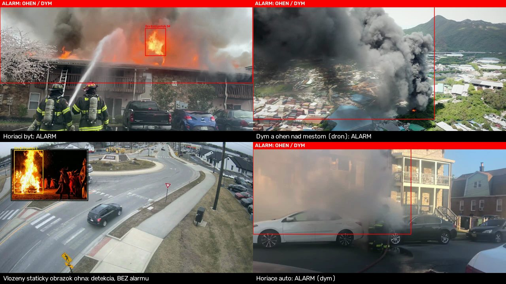
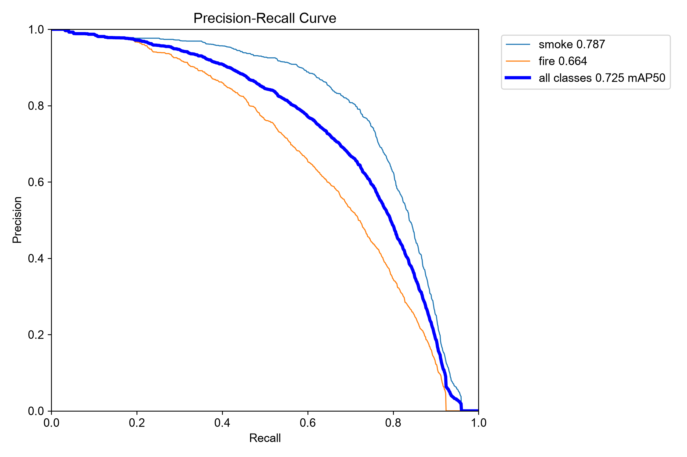
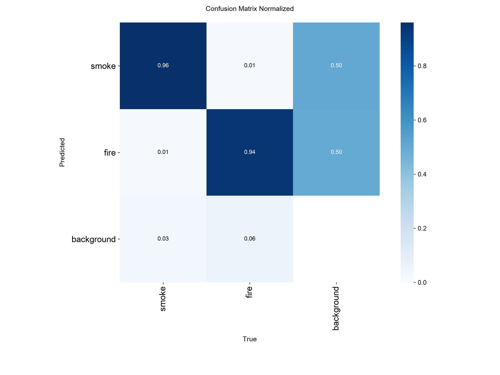
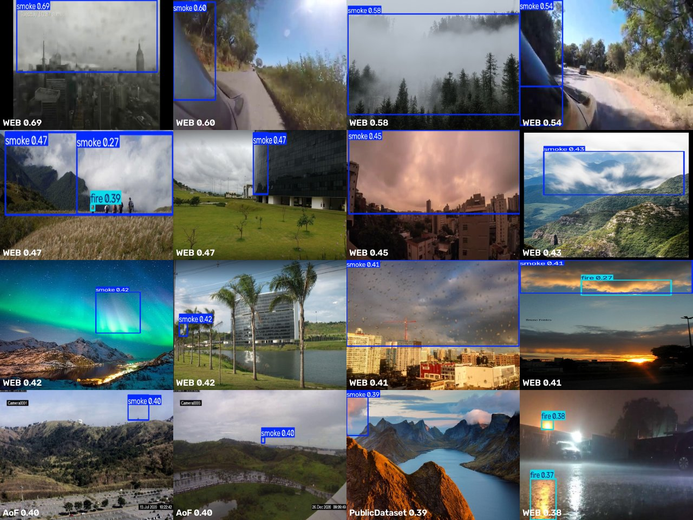

# R&D 12: Detekcia ohňa a dymu (Fire & Smoke Detection)

> **Stav:** hotové (prieskum + natrénovaný model + prototyp + vyhodnotenie). Riešil: Peter Štefanec, Jira SCRUM-16.
> Čísla v reporte sú namerané skriptmi v tomto priečinku (súbory v `results/`). Čísla z článkov majú vždy uvedený zdroj. Odhady sú výslovne označené ako odhad.

## TL;DR (na prezentáciu)

1. **Natrénoval som vlastný YOLOv8n na datasete D-Fire**: 21 527 obrázkov, z toho 9 838 bez ohňa a dymu, imgsz 512 ako na Jetsone, 20 epoch, 4,5 h na M2 MacBooku. Model má 6 MB: [`weights/fire_yolov8n_512.pt`](weights/fire_yolov8n_512.pt).
2. **Testovacia sada D-Fire (4 306 obrázkov):** mAP50 **0,725** (dym 0,787, oheň 0,664), mAP50-95 0,411. Na úrovni obrázka, teda „spustí sa poplach?“, pri conf 0,4: **zachytí 79 % obrázkov s ohňom alebo dymom a falošný poplach dá na 0,65 % obrázkov bez ohňa**. Pri conf 0,25 je to 90 % / 2,1 %.
3. **Klasické farebné pravidlo** (bez neurónky) má aj pri nižšej citlivosti (zachytí 64–71 % ohňov oproti 79–91 % pri YOLO) **29–43 % falošných poplachov**. Dym z princípu nevie detegovať, pretože hľadá len farbu plameňa.
4. **Prototyp** [`detect_fire_video.py`](detect_fire_video.py) pridáva časové overenie: *perzistencia* (detekcia musí vydržať v polovici snímok za posledné 3 s) + *pohyb* (obsah boxu sa za 1 s musí zmeniť). Pri **nasadení na 2 snímky/s**:
   - **digitálne vložený statický obrázok ohňa** na pevnej kamere: YOLO ho vidí na 100 % snímok, **alarm 0×**;
   - **10 negatívnych videí** (majáky, semafory, západ slnka, hasičské auto, následky požiaru; 178 s): **0 falošných poplachov**;
   - **3 skutočné požiare:** alarm **1,5–2,0 s po prvej detekcii**. Dym z komína dá alarm tiež, lebo je to skutočný dym.
5. **Rýchlosť:**
   - **Na M2 MacBooku:** 9–18 ms na snímku na GPU (MPS), 21–37 ms na CPU. Model má 5,6 GFLOPs pri 512 a časové overenie trvá ≤ 0,5 ms.
   - **Jetson:** nemerané. Dokumentácia Ultralytics uvádza pre YOLO26n pri 640 px s TensorRT FP16 2,6 ms na AGX Orin, bez pre- a post-processingu.
   - **Odhad pre Pezinok:** pri 2 fps na kameru je to rádovo 10 % GPU pre 20 kamier.
6. **Má to zmysel? Áno, ale ako samostatný model a s operátorom, ktorý alarm potvrdí.** Pre **TP1** ako demo a upozornenie v dashboarde (DEV13). Pre **TP2** ostré nasadenie, keď budú hard negatívy z kamier Pezinka (komíny, hmla, dážď) a zmeraný počet falošných poplachov za hodinu. Najväčšie očakávané riziká sú **hmla, nízke mraky, kvapky na objektíve a dym z komínov** (§5).


*Prototyp `detect_fire_video.py` (ukážka, každá 2. snímka videa). Červený box a banner znamenajú potvrdený alarm, žltý box surovú detekciu, ktorú filter nepotvrdil. Vľavo dole je digitálne vložený statický obrázok ohňa: YOLO ho vidí, ale nehýbe sa, preto alarm nie je.*

---

<details>
<summary><b>Pôvodné zadanie</b> (klikni)</summary>

## Cieľ výskumu
Zistiť, či a ako efektívne dokážeme detegovať oheň a dym z mestských kamier. Cieľom nie je nasadenie do produkcie (to je DEV-13), ale **prieskum možností, testovanie presnosti a výpočtovej náročnosti**.

## Čo treba preskúmať (Research)
1.  **Existujúce modely a datasety:** Preštudovať papers o detekcii ohňa (napr. zamerané na CCTV/urbánne prostredie). Nájsť open-source datasety (napr. `MultiFire20K` – ohne v meste, `D-Fire`, alebo datasety na Zenode).
2.  **Prístupy:**
    *   *Klasická detekcia (YOLO):* Dotrénovať YOLO26n (alebo YOLOv8n) na datasete s ohňom. Aká je presnosť? Aké sú falošné poplachy (napr. oranžové svetlá, západy slnka)?
    *   *Klasifikácia (CNN):* Použiť klasifikátor na výrezy, ktoré YOLO označí ako "podozrivé".
    *   *Časová analýza:* Ako rozlíšiť skutočný oheň od statického obrázka (napr. oheň na plagáte)? (Napr. sledovaním, či sa pixely menia v čase).
3.  **Výpočtová náročnosť:** Zmerať, koľko ms zaberie inferencia. Je to realizovateľné na Jetsone popri YOLO pre autá?

## Podklady
*   Testovacie video s ohňom (napr. z `MultiFire20K` (https://zenodo.org/records/17047113) alebo z YouTube – bezpečné zábery).
*   Negatívne príklady (napr. oranžové auto, západ slnka, červené svetlo), aby model nerobil falošné poplachy. sú napr. v `MS-FSDB` (https://github.com/XiaoyiHan6/MS-FSDB/tree/main) ten obsahuje 9000 negative samples na pomýlenie modelu.
*   Je možné použiť aj iné datasety, je to jedno.

## Výstup
1.  **Report (Markdown):**
    *   Aké datasety a modely ste našli.
    *   Aká je presnosť (napr. mAP, F1) na testovacích dátach.
    *   Aké sú falošné poplachy a ako ich eliminovať.
    *   Odporúčanie: Má zmysel to nasadiť? Ak áno, s akým modelom a za akých podmienok?
2.  **Prototyp (Python skript / Jupyter notebook):**
    *   Skript, ktorý načíta video, spustí detekciu ohňa a vykreslí bboxy.
    *   Zmeria čas inferencie.
3.  **Prezentácia (5 minút):**
    *   Ukázať demo na videu.
    *   Povedať, či to má zmysel pre TP1 alebo až pre TP2.

## Definition of Done
- [ ] Preštudované aspoň 2 vedecké papers o detekcii ohňa.
- [ ] Vyskúšaný aspoň 1 model (napr. YOLO dotrénovaný na ohni).
- [ ] Otestované na videu s ohňom a negatívnych príkladoch.
- [ ] Zmeraná výpočtová náročnosť (ms/snímka).
- [ ] Napísaný report a odprezentované na stretku.
</details>

## Definition of Done

- [x] Preštudované aspoň 2 vedecké papers o detekcii ohňa: [§6](#6-literatúra) (D-Fire, Muhammad et al. 2019, Foggia et al. 2015, Töreyin et al. 2006, de Venâncio et al. 2023, Catargiu et al. 2024, SmokeyNet 2022 a ďalšie)
- [x] Vyskúšaný aspoň 1 model: vlastný YOLOv8n dotrénovaný na D-Fire a klasické farebné pravidlo ako baseline
- [x] Otestované na videu s ohňom a negatívnych príkladoch: 3 videá s požiarom, 1 s dymom z komína, 10 negatívnych videí, 1 syntetický test so statickým obrázkom, 2 005 negatívnych obrázkov
- [x] Zmeraná výpočtová náročnosť (ms/snímka): [§4](#4-výpočtová-náročnosť-a-jetson)
- [x] Napísaný report (tento súbor), odprezentovanie na stretku zostáva

## 1. Súbory a spustenie

| Súbor | Čo robí |
|---|---|
| [`detect_fire_video.py`](detect_fire_video.py) | **Prototyp.** Video → YOLO oheň/dym → časové overenie (perzistencia v sekundách, pohyb za 1 s, podržanie alarmu 5 s). Výstup: video s boxami a bannerom ALARM, CSV po snímkach a JSON súhrn s ms/snímka a oneskorením alarmu. |
| [`weights/fire_yolov8n_512.pt`](weights/fire_yolov8n_512.pt) | **Natrénovaný model**: YOLOv8n, D-Fire, imgsz 512, triedy `0=smoke`, `1=fire`, 3,1 M parametrov, 6 MB |
| [`eval_fire.py`](eval_fire.py) | Vyhodnotenie na teste D-Fire: mAP, TPR a FPR na úrovni obrázka pre rôzne prahy, galéria falošných poplachov, ms/obrázok |
| [`color_rule_baseline.py`](color_rule_baseline.py) | Klasický baseline bez neurónky: farebné pravidlo YCbCr (Çelik & Demirel 2009) |
| [`make_synth_poster.py`](make_synth_poster.py) | Vyrobí syntetický test „statický obrázok ohňa na pevnej kamere“ |
| [`make_figures.py`](make_figures.py) | Vyrobí `results/figures/video_demo.jpg` a tabuľku z JSON súhrnov |
| [`download_data.sh`](download_data.sh), [`resize_dfire.py`](resize_dfire.py), [`dfire.yaml.example`](dfire.yaml.example) | Stiahnutie D-Fire (HF mirror, kontrola SHA256) a zmenšenie na 512 px. Dáta nie sú v gite. |
| `results/` | `eval_test.json`, `color_rule.csv`, `train_results.csv`, `videos/deploy_2fps/` (hlavný výsledok, aj CSV po snímkach), `videos/deploy_2fps_cpu/` (časy na CPU), `videos/demo_15fps/`, `videos/filter_ablation_2fps/`, PR krivka, confusion matrix, obrázky |

```bash
pip install -r requirements.txt
# demo na vlastnom videu (netreba sťahovať dataset)
python detect_fire_video.py --model weights/fire_yolov8n_512.pt --source moje_video.mp4 --out-dir runs/demo --fps-process 2
#   --min-motion 0   pre kameru, ktorá sa hýbe (PTZ pri otáčaní, video z ruky alebo z dronu)
#   --conf 0.4       predvolené (§3.1); zariadenie sa vyberie samo (CUDA -> MPS -> CPU)

# reprodukcia tréningu a vyhodnotenia (výstupy do runs/, ktorý je v .gitignore)
./download_data.sh                      # ~3,1 GB, overí SHA256 a vytvorí dfire512.yaml
yolo detect train model=../../models/yolov8n.pt data=dfire512.yaml imgsz=512 epochs=20 patience=8 close_mosaic=5 batch=32 device=mps deterministic=False project=runs   # na CUDA: device=0
python eval_fire.py --model weights/fire_yolov8n_512.pt --data dfire512.yaml --test-dir data/dfire512/test --out runs/eval
python color_rule_baseline.py --test-dir data/dfire512/test --out runs/color_rule.csv
```

Napojenie do pipeline (DEV13): trieda `TemporalVerifier` v `detect_fire_video.py` nezávisí od YOLO. Stačí jej posielať každú snímku cez `push_frame` a detekcie cez `update`.

## 2. Datasety a modely, ktoré som našiel

| Dataset | Obsah | Formát / licencia | Použitie |
|---|---|---|---|
| **D-Fire** (de Venâncio et al., *Neural Comput. Appl.* 2022) | 21 527 obrázkov: 1 164 len oheň, 5 867 len dym, 4 658 oboje, **9 838 negatívov**. 14 692 boxov ohňa, 11 865 dymu. Mix CCTV, webu a verejných datasetov (HPWREN, FESB, FireNet). | YOLO txt, **CC0** | ✅ **Tréning a test.** Oficiálne je len na OneDrive, preto som použil HF mirror `Stevebirth/fire-ulm-dfire`. SHA256 súhlasí, čo overuje len celistvosť sťahovania. Počty obrázkov a boxov sedia s oficiálnym README. Split 15 499 / 1 722 / 4 306, test zodpovedá oficiálnemu (4 306). |
| **MultiFire20K** (Shianios et al., *CVIU* 2025, [Zenodo](https://zenodo.org/records/17047113)) | 20 500 snímok **z dronu**, oheň / bez ohňa, segmentačné masky | 9,3 GB, CC BY 4.0 | ✗ **Nemá boxy ani dym a pohľad z dronu nie je CCTV.** Na detekciu sa nehodí. |
| **MS-FSDB** (Han et al., PRCV 2024, [arXiv](https://arxiv.org/abs/2410.16631)) | 12 586 obrázkov z 2 731 scén, ~8 983 negatívov (západy slnka, mraky…) | VOC XML, len Google Drive | ✗ Skriptom sa nedá stiahnuť. **V ďalšom týždni ho stiahnuť ručne** ako nezávislý test negatívov. |
| **FASDD** (Wang et al., *Geo-spatial Inf. Sci.* 2024) | ~122 tisíc obrázkov, podsúbor FASDD_CV z pozemných kamier, 39 tisíc negatívov | CC BY 4.0, 3,4 GB | Kandidát na nezávislý test, spolu s D-Fire sa nevošiel na disk |
| **Catargiu et al.** (*Sensors* 2024) | 22 970 obrázkov z YouTube, trieda **„other“** (pouličné lampy, reflektory, **majáky**, západy slnka) | Roboflow (treba účet) | Najbližšie k mestským rušivým objektom. Odporúčam pre TP2. |
| **DFS** (Wu et al., *MTAP* 2022) | 9 462 obrázkov, trieda „other“ pre svetlá podobné ohňu | VOC, Baidu/OneDrive | Pre TP2 |
| Komunitný YOLOv8n na D-Fire ([HF](https://huggingface.co/rabahdev/fire-smoke-yolov8n)) | Podľa karty modelu mAP50 0,754, mAP50-95 0,430 (640 px, 50 epoch). Nie je recenzovaný. | AGPL-3.0, `.pt` | Len ako referencia čísel. **Nesťahoval som ho**, lebo `.pt` je pickle a pri načítaní môže spustiť cudzí kód. Natrénoval som vlastný. |

**Prečo YOLOv8n a nie YOLO26n:**
- V krátkom teste na M2 (forward + backward, batch 32, 512 px) trval jeden krok YOLO26n 2,0 s a YOLOv8n 1,1 s. Celý tréning YOLO26n som nespúšťal, takže „~2× dlhšie“ je len odhad.
- YOLOv8n repozitár už používa (`models/yolov8n_b1_512.engine`).
- Na Jetsone sa YOLO26n oplatí vyskúšať, lebo nepotrebuje NMS.

## 3. Výsledky

### 3.1 Testovacia sada D-Fire (4 306 obrázkov, z toho 2 005 bez ohňa a dymu)

**Box metriky** (Ultralytics `val`, split=test, imgsz 512):

| Trieda | Precision | Recall | mAP50 | mAP50-95 |
|---|---|---|---|---|
| dym (smoke) | 0.779 | 0.726 | **0.787** | 0.479 |
| oheň (fire) | 0.673 | 0.586 | **0.664** | 0.343 |
| **spolu** | 0.726 | 0.656 | **0.725** | **0.411** |

- **Porovnanie:** komunitný YOLOv8n na D-Fire uvádza 0,754 / 0,430 pri 640 px a 50 epochách, takže náš model (512 px, 20 epoch) je porovnateľný.
- **Prečo má oheň nižšie mAP ako dym:** boxy ohňa sú často malé (plamienky v diaľke) a anotácie sú nejednotné (raz jeden veľký box, inokedy niekoľko malých).

<p align="center"> </p>

**Na úrovni obrázka** (pre mesto podstatné: spustí sa poplach?):
- **TPR** = podiel obrázkov s ohňom alebo dymom, kde model niečo našiel.
- **FPR** = podiel obrázkov **bez** ohňa a dymu, kde model niečo našiel, teda falošný poplach.

| conf | TPR (oheň alebo dym) | TPR oheň | TPR dym | **FPR** | FPR (len „fire“) | FPR (len „smoke“) |
|---|---|---|---|---|---|---|
| 0.10 | 0.961 | 0.967 | 0.955 | 0.075 | 0.017 | 0.061 |
| 0.25 | 0.899 | 0.907 | 0.862 | 0.021 | 0.004 | 0.019 |
| **0.40** | **0.790** | 0.787 | 0.710 | **0.0065** | 0.000 | 0.0065 |
| 0.50 | 0.689 | 0.638 | 0.594 | 0.002 | 0.000 | 0.002 |
| 0.60 | 0.562 | 0.478 | 0.474 | 0.001 | 0.000 | 0.001 |

- **Takmer všetky falošné poplachy sú „dym“.** Trieda „oheň“ pri conf ≥ 0,4 na 2 005 negatívoch nevznikla ani raz.
- **FPR podľa zdroja (conf 0,25):**
  - AoF (995 negatívov): 1,8 %.
  - WEB (979 negatívov): 2,0 %.
  - PublicDataset (HPWREN/FESB/FireNet): 16 %, ale je to len 31 obrázkov, teda 5 kusov.

**Čo model mýli s ohňom alebo dymom** (16 negatívnych obrázkov s najvyšším skóre):



- **Na obrázku:** hmla, nízke mraky, opar nad mestom, kvapky na objektíve, západ slnka, odlesky svetiel na mokrej ceste. Okrem toho polárna žiara, sklenená fasáda a kapota auta z palubnej kamery.
- **Súlad s literatúrou:** zhoduje sa s typmi falošných poplachov, ktoré uvádzajú SmokeyNet (mraky a opar) a Catargiu et al. (svetlá a odlesky).
- **Očakávanie pre Pezinok:** na mestskej kamere budú hlavným rizikom pravdepodobne ranná hmla a dážď.

Ukážky správnych detekcií: [`results/figures/detections_examples.jpg`](results/figures/detections_examples.jpg). Krivky tréningu: [`results/figures/train_curves.png`](results/figures/train_curves.png).

### 3.2 Klasické farebné pravidlo (baseline bez neurónky)

Çelik & Demirel (2009), pravidlo v priestore YCbCr, τ = 40. Obrázok je „oheň“, ak ohňové pixely tvoria aspoň p % plochy:

| min. podiel ohňových pixelov | TPR oheň | FPR (negatívy) |
|---|---|---|
| 0,1 % | 0.710 | **0.430** |
| 0,5 % | 0.635 | 0.289 |
| 1 % | 0.584 | 0.231 |
| 5 % | 0.361 | 0.109 |
| **YOLO, conf 0,25 / 0,4** | **0.907 / 0.787** | **0.004 / 0.000** (len „fire“) |

- **Farba nestačí:** oranžové a červené objekty, svetlá aj západ slnka majú „ohňovú“ farbu.
- **Literatúra:** podobný záver uvádza Muhammad et al. (2019, Tab. II). Na videách MIVIA má pravidlo Çelik 29,4 % falošných poplachov a ich CNN 8,9 %.

### 3.3 Videá a časové overenie

**Ako funguje [`TemporalVerifier`](detect_fire_video.py):**
1. **Perzistencia:** trieda musí byť v aspoň **50 % spracovaných snímok za posledné 3 s**. Okno je v sekundách, takže sa správa rovnako pri 2 aj 15 spracovaných snímkach za sekundu. Pri 2 fps to znamená 3 zo 6 snímok.
2. **Pohyb (len pevná kamera):** priemerný absolútny rozdiel jasu v boxe oproti snímke **spred 1 s** musí byť aspoň 6.
   - **Namerané:** vložený statický obrázok má medián 0,8. Skutočný oheň a dym na videách majú mediány okolo 12–21.
   - **Prečo 1 s:** v prvej verzii som porovnával so susednou snímkou (67 ms). Pomaly sa valiaci dym z dronu sa za ten čas takmer nezmenil (orientačné meranie počas vývoja: medián ~1,3), takže alarm neprešiel.
   - **Zahrievanie:** prvú sekundu po štarte sa pohyb nedá zmerať a alarm sa nespustí.
3. **Podržanie alarmu:** alarm drží **5 s** po poslednom potvrdení, aby operátor dostal jednu udalosť, a nie blikanie.

**Hlavný výsledok: nasadenie na 2 snímky/s**, conf 0,4, imgsz 512 ([`results/videos/deploy_2fps/`](results/videos/deploy_2fps)). Videá sú voľne licencované, [zdroje](#zdroje-videí).

- „Surová detekcia“ a „potvrdené“ sú podiely spracovaných snímok.
- „Oneskorenie“ je čas od prvej surovej detekcie po alarm.

| Video | Typ | Trvanie | surová detekcia | potvrdené | **udalosti alarmu** | oneskorenie alarmu |
|---|---|---|---|---|---|---|
| Horiaci byt (Pexels 4116863) | 🔥 oheň + dym | 6,8 s | 100 % | 71 % | 1 | **2,0 s** |
| Dym a oheň nad mestom, dron (Pexels 8365993) | 🔥 dym + oheň | 29,0 s | 100 % | 93 % | 1 | **2,0 s** |
| Horiace auto, hasiči (Wikimedia) | 🔥 oheň → dym z hasenia | 154,8 s | 14 % | 10 % | 3 | **1,5 s** |
| Dym z komína (Wikimedia) | ⚠️ skutočný, ale neškodný dym | 10,6 s | 91 % | 78 % | 1 | 1,9 s |
| **Statický obrázok ohňa na pevnej kamere** (syntetický: RoundaboutHD z repozitára + vložená fotka) | ❌ statický obrázok | 60 s | **100 %** | **0 %** | **0** | – |
| Majáky záchranky (Pexels 8944148) | ❌ | 13,7 s | 3,4 % | 0 % | 0 | – |
| Semafory v noci (Pixabay 6455) | ❌ | 15,7 s | 0 % | 0 % | 0 | – |
| Červené slnko v opare (Pixabay 222324) | ❌ | 11,2 s | 0 % | 0 % | 0 | – |
| Západ slnka (Wikimedia) | ❌ | 14,6 s | 0 % | 0 % | 0 | – |
| Hasičské auto so sirénou (Wikimedia) | ❌ | 20,4 s | 0 % | 0 % | 0 | – |
| Premávka za súmraku (Pexels 3905138) | ❌ | 23,2 s | 0 % | 0 % | 0 | – |
| Most v noci (Wikimedia) | ❌ | 40,5 s | 0 % | 0 % | 0 | – |
| Zhorené strechy po požiari, dron (Pixabay 46502 / 46506) | ❌ | 13,5 / 15,3 s | 0 / 0 % | 0 / 0 % | 0 / 0 | – |
| Upratovanie po požiari (Pixabay 155293) | ❌ | 10,4 s | 0 % | 0 % | 0 | – |

**Poznámky k videám:**
- **Horiaci byt a dron:** oheň je viditeľný od prvej snímky, prvá detekcia je v čase 0 a alarm po 2,0 s. To je čas na naplnenie okna perzistencie a 1 s zahrievania testu pohybu.
- **Horiace auto:**
  - Video začína úvodnou kartou hasičov a plamene sú vidno približne od 6. s. Prvá detekcia (conf 0,4) prišla v 9,5 s a alarm v 11,0 s.
  - Trieda „oheň“ sa objavuje len v prvých 20 s. Ďalšie dve udalosti (21,5 s a 43 s) sú **dym z hasenia**, ktorý sa objavuje a mizne.
  - Po 60 s je už len uhasené auto a záverečná karta, preto sú podiely za celé video nízke.
- **Pri každej 2. snímke videa** (7,5–30, väčšinou 15 spracovaných snímok/s; [`results/videos/demo_15fps/`](results/videos/demo_15fps)) sú negatívy rovnaké, teda 0 udalostí. Oneskorenie je 2,5 s pri byte a drone a 14 s pri horiacom aute, kde je dym prerušovaný a 50 % snímok za 3 s sa naplní neskôr.

**Vplyv jednotlivých častí filtra pri 2 snímkach/s** (podiel **potvrdených** snímok bez podržania alarmu, [`results/videos/filter_ablation_2fps/`](results/videos/filter_ablation_2fps)):

| Video | surové YOLO (conf 0,25) | + perzistencia | + pohyb za 1 s | + conf 0,4 | finál (+ podržanie 5 s): udalosti |
|---|---|---|---|---|---|
| Statický obrázok ohňa (pevná kamera) | 100 % | 98 % (1 udalosť) | **0 %** | **0 %** | **0** |
| Semafory v noci | 25 % | 12 % (4 udalosti) | 9 % (3) | **0 %** | **0** |
| Majáky záchranky | 21 % | 7 % (1) | 7 % (1) | **0 %** | **0** |
| Červené slnko v opare | 4 % | 0 % | 0 % | 0 % | 0 |
| Upratovanie po požiari | 5 % | 0 % | 0 % | 0 % | 0 |
| Horiaci byt | 100 % | 86 % | 71 % | 71 % | 1 |
| Dym a oheň nad mestom (dron) | 100 % | 97 % | 93 % | 93 % | 1 |
| Horiace auto | 24 % | 21 % (16 udalostí) | 21 % (16) | 10 % (10) | 3 |
| Dym z komína | 100 % | 91 % | 78 % | 78 % | 1 |

- **Perzistencia** odstráni krátke záblesky (semafory z 25 % na 12 %).
- **Test pohybu** ako jediný odhalí **statický obrázok ohňa**, presne podľa otázky zo zadania.
  - **Platí len pre pevnú kameru.** Na videu z ruky, z dronu alebo na PTZ kamere počas otáčania sa hýbe všetko. Dron a horiace auto v tabuľke prešli testom aj preto, že sa hýbala kamera. V nasadení na takých kamerách sa test vypína (`--min-motion 0`).
  - **Test je optimistický.** Obrázok je vložený digitálne. Skutočný vytlačený plagát by mal aj zmeny osvetlenia, autoexpozície a autá idúce popred neho, takže pohyb by mohol presiahnuť prah. **Treba overiť na skutočnom plagáte alebo obrazovke** pred kamerou.
- **Conf 0,4** odstráni zvyšné detekcie svetiel. Pri semaforoch to bola trieda „oheň“, pri majákoch „dym“.
  - **Cena:** pri horiacom aute klesne podiel potvrdených snímok na polovicu (21 % → 10 %) a pri 15 fps sa prvý alarm oneskorí. Je to kompromis medzi falošnými poplachmi a rýchlosťou.
- **Dym z komína** systém správne rozpozná ako dym, ale pre mesto je to falošný poplach. Očakávame, že v zime v Pezinku (rodinné domy s vykurovaním) to bude častý problém. Riešenia sú v §5.

⚠️ **Obmedzenie:** 3 videá s požiarom a 10 bez ohňa stačia na demo a overenie princípu. **Na spoľahlivé číslo „falošných poplachov za hodinu“ nestačia.** Na to treba niekoľko hodín záznamov z kamier v Pezinku (deň, noc, dážď, hmla).

## 4. Výpočtová náročnosť a Jetson

| | Hodnota | Poznámka |
|---|---|---|
| YOLOv8n fire `predict` (imgsz 512, vrátane pre- a post-processingu) | **M2 GPU (MPS): 9–18 ms**, M2 CPU: 21–37 ms | MPS: medián na videách 9–16 ms ([`deploy_2fps`](results/videos/deploy_2fps)), na testovacích obrázkoch 17,7 ms. CPU: ten istý beh s `--device cpu` ([`deploy_2fps_cpu`](results/videos/deploy_2fps_cpu)). |
| `TemporalVerifier` | medián ≤ 0,41 ms, p95 ≤ 0,5 ms | + ~0,2 ms na každú snímku videa (`push_frame`: prevod na sivú a rozmazanie) |
| GFLOPs | **5,6** pri 512 (8,75 pri 640) | thop, 3,14 M parametrov |
| Tréning | 20 epoch, spolu 4,5 h | 15 499 obrázkov, batch 32, M2 MPS |

**Jetson AGX Orin:** zatiaľ **nemerané**.
- **Referencia z dokumentácie Ultralytics** (iný model aj rozlíšenie): YOLO26n pri 640 px, TensorRT FP16, **2,62 ms**, bez pre- a post-processingu.
- **Náš model:** YOLOv8n pri 512 potrebuje navyše NMS. Treba ho zmerať na našom Jetsone spolu s bežiacim vozidlovým modelom.

**Odhad záťaže (len rádový, náš):** 20 kamier × 2 fps × ~3 ms ≈ 120 ms GPU času za sekundu, teda **~12 % GPU**. Neráta dekódovanie videa ani súbeh s vozidlovým modelom.
- **Prečo 2 fps:** je to naše inžinierske rozhodnutie. Oheň a dym sa vyvíjajú v sekundách, nie v milisekundách, a celé časové overenie je definované v sekundách.
- **Čo ukázali testy:** 2 fps dalo rovnako dobré výsledky ako ~15 fps (§3.3).

**Samostatný model, alebo zlúčiť s vozidlami?** Samostatný.
- **Výhody:** beží len 2× za sekundu, nemení presnosť vozidlového modelu ani ReID a dá sa rýchlo pretrénovať.
- **Prečo nie zlúčiť:** potrebovali by sme dataset, v ktorom sú označené autá aj oheň naraz.

## 5. Falošné poplachy a ako ich eliminovať

| Rušivý objekt | Čo sme videli | Riešenie (✅ v prototype, ➕ návrh) |
|---|---|---|
| **Hmla, nízke mraky, opar** | Najčastejšie FP na testovacej sade (trieda dym) | ✅ conf 0,4 · ➕ dlhšie potvrdenie dymu ako ohňa · ➕ maska oblohy (SmokeyNet orezáva oblohu) · ➕ hard negatívy z Pezinka do tréningu |
| **Kvapky na objektíve, odlesky na mokrej ceste** | Na testovacej sade | ➕ hydrofilný kryt kamery (úloha 04) · ➕ hard negatívy |
| **Majáky, semafory, svetlá áut** | 21–25 % snímok → 0 % | ✅ perzistencia + conf 0,4 · ➕ potlačiť boxy, ktoré sa hýbu spolu s trackom auta (nie však stojace horiace auto!) · ➕ trieda „other“ (Catargiu et al., DFS) |
| **Statický obrázok, plagát** | 100 % → 0 % (syntetický test) | ✅ test pohybu za 1 s (len pevná kamera) · ➕ overiť na skutočnom plagáte alebo obrazovke |
| **Západ slnka, červené slnko** | 4 % → 0 % | ✅ conf 0,4 · D-Fire má veľa takýchto negatívov |
| **Dym z komína, para, výfuk** | Alarm (správne „dym“, ale neškodný) | ➕ masky známych komínov na každej kamere · ➕ dym hlásiť až po 30–60 s · ➕ potvrdenie operátorom |
| **Červené strechy, autá, oblečenie** | 0 % (zhorené strechy, hasičské auto) | negatívy z D-Fire zatiaľ stačia |

**Krok s najväčším očakávaným efektom (TP2):**
1. Pustiť model na pár dní záznamov z kamier v Pezinku a nazbierať falošné poplachy.
2. Pridať ich do tréningu ako obrázky s prázdnymi labelmi (*hard negative mining*) a model pretrénovať.

**Dvojstupňový klasifikátor výrezov** (bod 2 zadania) má zmysel až potom, ak falošné poplachy zostanú. Kandidáti sú malé CNN z Dunnings & Breckon (2018) alebo MobileNet na výrezoch.

## 6. Literatúra

| Článok | Prístup | Čo z toho plynie pre nás |
|---|---|---|
| **de Venâncio, Lisboa, Barbosa**: *An automatic fire detection system based on deep convolutional neural networks for low-power, resource-constrained devices*, Neural Comput. Appl. 34, 2022 ([DOI](https://doi.org/10.1007/s00521-022-07467-z)) | Dataset **D-Fire** + YOLOv4 s prerezaním filtrov pre slabé zariadenia | Náš tréningový dataset. Malé modely na edge zariadeniach dávajú zmysel. |
| **de Venâncio et al.**: *A hybrid method for fire detection based on spatial and temporal patterns*, Neural Comput. Appl. 35, 2023 ([DOI](https://doi.org/10.1007/s00521-023-08260-2)) | CNN nájde kandidátov, potom **časová analýza** ich vývoja | Rovnaký princíp ako náš prototyp. Podľa abstraktu časová fáza zníži FP bez výrazného vplyvu na TP. |
| **Muhammad et al.**: *Efficient Deep CNN-Based Fire Detection and Localization in Video Surveillance Applications*, IEEE TSMC 49(7), 2019 ([DOI](https://doi.org/10.1109/TSMC.2018.2830099)) | SqueezeNet CNN pre CCTV, 3 MB | Tab. II (MIVIA): CNN má 8,9 % FP, farebné pravidlo 29,4 %. 20 fps na GPU, 4 fps na Raspberry Pi 3. |
| **Foggia, Saggese, Vento**: *Real-Time Fire Detection for Video-Surveillance Applications Using a Combination of Experts Based on Color, Shape, and Motion*, IEEE TCSVT 25(9), 2015 ([DOI](https://doi.org/10.1109/TCSVT.2015.2392531)) | Experti na farbu, tvar a pohyb | Klasický video prístup. Pohyb a zmena tvaru sú lacné doplnky k YOLO. Dataset MIVIA má 31 videí. |
| **Töreyin et al.**: *Computer vision based method for real-time fire and flame detection*, Pattern Recognit. Lett. 27(1), 2006 ([DOI](https://doi.org/10.1016/j.patrec.2005.06.015)) | Blikanie plameňa okolo 10 Hz (wavelet) | Odtiaľ pochádza myšlienka, že oheň bliká. Pri nízkom fps a silnej kompresii je blikanie horšie viditeľné, preto meriame zmenu za 1 s. |
| **Dewangan et al.**: *FIgLib & SmokeyNet*, Remote Sensing 14(4), 2022 ([DOI](https://doi.org/10.3390/rs14041007)) | Dym: CNN + LSTM cez snímky + ViT | Tab. 2: časový model má vyššiu precision (89,8 % vs 63,4 % pre jednu snímku), ale nižší recall (76,5 % vs 89,9 %) a pomalšiu detekciu (3,1 vs 1,0 min). **Hlavné FP sú mraky a opar.** Orezávajú oblohu. |
| **Catargiu, Cleju, Ciocoiu**: *A Comparative Performance Evaluation of YOLO-Type Detectors on a New Open Fire and Smoke Dataset*, Sensors 24(17), 2024 ([DOI](https://doi.org/10.3390/s24175597)) | YOLOv5–v10 a YOLO-NAS na 23 tisíc obrázkoch, trieda „other“ (lampy, reflektory, majáky) | Tab. 5: YOLOv5–v10 dosahujú ~0,91 mAP50 pre oheň, YOLO-NAS 0,84. *Naša interpretácia:* verzia YOLO asi nie je úzke hrdlo, dáta áno. |
| **Kim & Lee**: *A Video-Based Fire Detection Using Deep Learning Models*, Applied Sciences 9(14), 2019 ([DOI](https://doi.org/10.3390/app9142862)) | Faster R-CNN + LSTM + hlasovanie v čase | Podľa abstraktu časové hlasovanie znižuje FP aj FN |
| **Çelik & Demirel**: *Fire detection in video sequences using a generic color model*, Fire Safety J. 44(2), 2009 ([DOI](https://doi.org/10.1016/j.firesaf.2008.05.005)) | Farebné pravidlo YCbCr | Náš baseline (§3.2) |
| **Dunnings & Breckon**: *Experimentally Defined CNN Architecture Variants for Non-Temporal Real-Time Fire Detection*, ICIP 2018 ([DOI](https://doi.org/10.1109/ICIP.2018.8451657)) | Malé CNN, verejné váhy | Kandidát na druhý stupeň (klasifikátor výrezov) |
| **Han et al.**: *Benchmarking Multi-Scene Fire and Smoke Detection* (MS-FSDB), PRCV 2024 ([arXiv](https://arxiv.org/abs/2410.16631)) | Zjednotený benchmark naprieč scénami | *Náš záver:* treba aj test na inom datasete, nielen na teste D-Fire |
| **Shianios et al.**: *MultiFire20K*, CVIU 254, 2025 ([DOI](https://doi.org/10.1016/j.cviu.2025.104318)) | Dataset z dronu, segmentačné masky | Pre detekciu na CCTV nevhodný (nemá boxy) |
| Prehľady: Çetin et al., *Video fire detection – Review*, DSP 2013 · Gaur et al., *Fire Technology* 2020 | | |

## 7. Odporúčanie: má zmysel to nasadiť?

**Áno, ako doplnková funkcia, nie ako autonómny hasičský alarm.**

| | TP1 (teraz) | TP2 (neskôr) |
|---|---|---|
| Model | tento YOLOv8n (D-Fire, 512) → TensorRT FP16 na Jetsone | pretrénovaný s hard negatívmi z Pezinka (+ prípadne trieda „other“, D-Fire + Catargiu) |
| Frekvencia | 2 fps na kameru, samostatný model | rovnako |
| Filter | perzistencia 3 s + pohyb (pevné kamery) + conf 0,4 + podržanie 5 s | + masky komínov a oblohy, dlhšie potvrdenie dymu, potlačenie svetiel na trackoch áut |
| Výstup | **upozornenie v dashboarde (DEV13) s výrezom, ktorý potvrdí operátor** | automatické notifikácie, až keď bude zmeraný počet FP za kamera-hodinu |
| Podmienky | pevné kamery, na PTZ len v stojacom presete (počas otáčania `--min-motion 0` alebo pauza) | |

**Čo treba ešte overiť:**
1. Beh na reálnych záznamoch z Pezinka: počet falošných poplachov za hodinu, hlavne v hmle, v daždi a pri komínoch v zime.
2. Rýchlosť na Jetsone popri vozidlovom YOLO.
3. Test na inom datasete (MS-FSDB alebo FASDD_CV).
4. Test pohybu na skutočnom plagáte alebo obrazovke.

## Zdroje videí

- **Pexels** (Pexels License): 4116863, 8365993, 8944148, 3905138
- **Pixabay** (Pixabay Content License): 46502, 46506, 155293, 222324, 6455
- **Wikimedia Commons:**
  - *Car Fire 8-24-18 – Perth Amboy FD* (CC BY 3.0)
  - *Chimney smoke video dec 09* (CC BY-SA 3.0)
  - *Firefighting truck responding sirens in Helsinki (2019)* (CC BY-SA 4.0)
  - *Sunset seen from the window of the John Bull pub, Moscow* (CC BY 2.0)
  - *Traffic on bridge at night* (CC BY 3.0)
- **Syntetický test:** RoundaboutHD (`data/videos/RoundaboutHD/kamera1_hd_1min.mp4` z repozitára) + testovací obrázok D-Fire `WEB10606.jpg`, vyrobený skriptom [`make_synth_poster.py`](make_synth_poster.py).

Videá nie sú v gite. Výsledky (CSV a JSON) sú v `results/videos/`.
